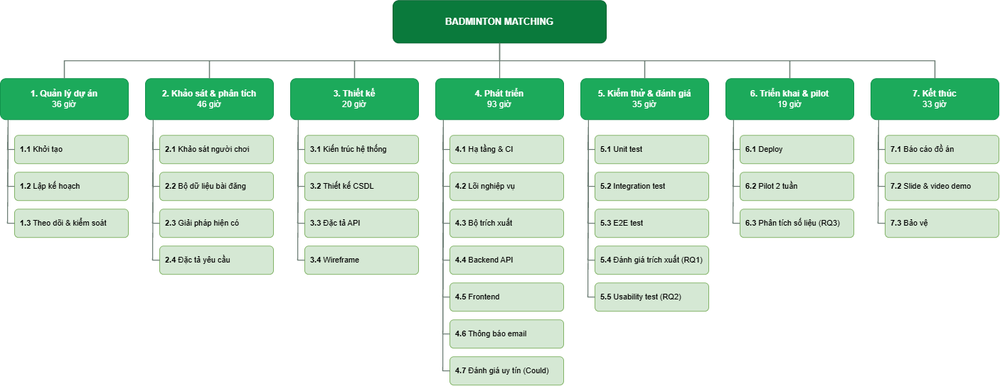

# WBS – CẤU TRÚC PHÂN RÃ CÔNG VIỆC

**Sinh viên thực hiện:** An Đức Mạnh – MSSV 23110310 · Đồ án cá nhân
Phiên bản 1.4 – 24/11/2026 · Phương pháp: phân rã theo **giai đoạn → gói công việc**. Mỗi gói công việc có sản phẩm đầu ra, ước lượng công và mức ưu tiên rõ ràng.

**Lộ trình 2 giai đoạn:** giai đoạn 1 là **ứng dụng web** (phạm vi đồ án, mục 1–4 của tài liệu này, 262 giờ công, **hạn hoàn thành 15/12/2026** ở mốc M5). Giai đoạn 2 là **app di động**, làm sau khi bảo vệ (mục 5), không tính vào khối lượng đồ án.

**Ưu tiên (MoSCoW):** M = Must · S = Should · C = Could (chỉ làm nếu còn thời gian)
**Trạng thái:** Xong · Đang làm · Chưa (chưa bắt đầu)

## 1. Sơ đồ tổng quan (cấp 1–2)

Bản vẽ gốc chỉnh sửa được: [diagrams/wbs-tong-quan.drawio](diagrams/wbs-tong-quan.drawio) (mở bằng https://app.diagrams.net hoặc extension Draw.io Integration trong VS Code). Sửa xong thì xuất lại PNG và ghi đè `diagrams/wbs-tong-quan.png`.

## 2. Bảng WBS chi tiết

| Mã | Gói công việc | Sản phẩm đầu ra | Ưu tiên | Giờ công | Phụ thuộc | TT |
|---|---|---|:-:|---:|---|:-:|
| **1** | **QUẢN LÝ DỰ ÁN** | | | **31** | | |
| 1.1.1 | Chốt đề tài chính thức | Tên đề tài, câu hỏi nghiên cứu | M | 4 | – | Xong |
| 1.1.2 | Lập Project Charter | [01-project-charter.md](01-project-charter.md) | M | 8 | 1.1.1 | Xong |
| 1.2.1 | Lập WBS | Tài liệu này | M | 4 | 1.1.2 | Xong |
| 1.2.2 | Lập Gantt chart | [03-gantt.md](03-gantt.md) | M | 3 | 1.2.1 | Xong |
| 1.2.3 | Kế hoạch quản lý rủi ro + kế hoạch chất lượng | `docs/RISKS.md`, `docs/QUALITY.md` | M | 3 | 1.1.2 | Xong |
| 1.3.1 | Nhật ký tiến độ hằng tuần | Weekly log (việc đã làm / kế hoạch / vướng mắc) | M | 5 | – | Đang làm |
| 1.3.2 | Gặp và báo cáo GVHD | Báo cáo 2 tuần/lần | M | 4 | – | Chưa |
| **2** | **KHẢO SÁT & PHÂN TÍCH** | | | **33** | | |
| 2.1.1 | Thiết kế bảng hỏi (kèm phiếu đồng ý) | Google Form | M | 3 | 1.1.2 | Chưa |
| 2.1.2 | Thu thập ≥ 30 phản hồi | Dữ liệu khảo sát | M | 3 | 2.1.1 | Chưa |
| 2.1.3 | Phân tích kết quả khảo sát | Báo cáo khảo sát (D2) | M | 3 | 2.1.2 | Chưa |
| 2.2.1 | Quy trình thu thập & ẩn danh hóa | Hướng dẫn gán nhãn | M | 2 | 1.1.2 | Chưa |
| 2.2.2 | Thu thập ≥ 100 bài đăng | Dữ liệu thô đã ẩn danh | M | 4 | 2.2.1 | Chưa |
| 2.2.3 | Gán nhãn chuẩn (ground truth) + đo độ đồng thuận (κ trên 30 bài) | Bộ dữ liệu gán nhãn (D3), Cohen's κ | M | 6 | 2.2.2 | Chưa |
| 2.3 | Phân tích giải pháp hiện có | Bảng so sánh | S | 3 | – | Chưa |
| 2.4.1 | User stories + use case (MoSCoW) | Product backlog: [04-user-stories.md](04-user-stories.md) (31 story, 14 use case) | M | 5 | 2.1.3 | Xong |
| 2.4.2 | Đặc tả yêu cầu + quy tắc nghiệp vụ (mã BR-xx) | `docs/project.md` (D4) | M | 4 | 2.4.1 | Đang làm |
| **3** | **THIẾT KẾ** | | | **15** | | |
| 3.1 | Kiến trúc hệ thống (modular monolith) | Sơ đồ kiến trúc trong `docs/project.md` | M | 4 | 2.4.1 | Xong |
| 3.2 | Thiết kế CSDL (MongoDB collections, index) | `docs/database.md` | M | 4 | 3.1 | Xong |
| 3.3 | Đặc tả API (endpoint, định dạng response, mã lỗi) | `docs/API.md` | M | 4 | 3.1 | Xong |
| 3.4 | Wireframe các màn hình chính (từ giao diện đã làm) | Wireframe (Figma / giấy) | M | 3 | 4.5.1, 4.5.2 | Chưa |
| **4** | **PHÁT TRIỂN** | | | **101** | | |
| 4.1.1 | Khởi tạo repo, cấu trúc mã nguồn | Repo + TypeScript + Vitest | M | 2 | – | Xong |
| 4.1.2 | Cấu hình CI (GitHub Actions) + quy ước Git/PR | `.github/workflows/ci.yml`, `docs/GIT.md` | M | 2 | 4.1.1 | Xong |
| 4.1.3 | Khung dự án + môi trường chạy thật (máy chủ Ubuntu: Nginx, PM2, MongoDB; [DEPLOY.md](DEPLOY.md)) | Ứng dụng chạy được ở local và trên máy chủ | M | 3 | 3.1 | Xong |
| 4.2 | Lõi nghiệp vụ: kèo, chỗ, trình độ | `backend/src/modules/post/post.rules.js` | M | 8 | 4.1.1 | Xong |
| 4.3.1 | Bộ trích xuất dựa trên luật, tinh chỉnh theo phân tích lỗi trên tập phát triển | `backend/src/modules/parser/` | M | 12 | 4.1.1, 2.2.3 | Đang làm |
| 4.4.1 | Xác thực (email + mật khẩu, JWT) | Đăng nhập hoạt động | M | 4 | 4.1.3 | Xong |
| 4.4.2 | API kèo + tham gia/rời | API posts | M | 10 | 4.2, 4.4.1 | Xong |
| 4.4.3 | Tìm kiếm theo khu vực / ngày / trình độ | API search | M | 8 | 4.4.2 | Xong |
| 4.5.1 | Màn hình đăng kèo + dán-tự-điền | UI đăng kèo | M | 12 | 4.3.1 | Xong |
| 4.5.2 | Danh sách kèo + bộ lọc | UI tìm kèo | M | 10 | 4.4.3 | Xong |
| 4.5.3 | Trang cá nhân | UI profile | S | 5 | 4.4.1 | Xong |
| 4.6 | Thông báo qua email | Module notify | S | 4 | 4.4.2 | Chưa |
| 4.7 | Đánh giá uy tín sau kèo | API + UI rating | C | 6 | 4.4.2 | Chưa |
| 4.8.1 | Thu tiền kèo bằng mã QR chuyển khoản (VietQR): số tài khoản trong hồ sơ, QR đúng giá mỗi người, chủ kèo đánh dấu đã trả | API + UI thanh toán kèo (US-32) | S | 6 | 4.4.2 | Xong |
| 4.8.2 | Chốt chi phí sau buổi: nhập tiền sân / cầu / nước, đánh dấu người có mặt, chia đều cho người có mặt | API + UI chốt chi phí (US-33, gồm điểm danh của US-28) | S | 5 | 4.8.1 | Chưa |
| 4.8.3 | Cài web lên màn hình chính (PWA: manifest, biểu tượng) | `manifest.webmanifest`, biểu tượng | S | 2 | 4.5.2 | Chưa |
| 4.8.4 | Tin nhắn tổng kết kèo để sao chép / chia sẻ sang Zalo, Facebook | Nút "Sao chép" ở chi tiết kèo (US-35, gộp US-14) | S | 1 | 4.8.1 | Chưa |
| 4.8.5 | Lịch sử chi tiêu theo tháng | Mục trong "Kèo của tôi" (US-36) | C | 1 | 4.8.2 | Chưa |
| **5** | **KIỂM THỬ & ĐÁNH GIÁ** | | | **34** | | |
| 5.1 | Unit test (liên tục, coverage ≥ 80%) | `backend/tests/` (Jest), test frontend (Vitest) | M | 12 | 4.1.2 | Đang làm |
| 5.2 | Integration / API test | Jest + Supertest + MongoDB trong RAM | M | 6 | 4.4.2 | Xong |
| 5.3 | E2E test cho 3 luồng chính (đăng, tìm, tham gia) | Bộ test Playwright | S | 5 | 4.5.2 | Chưa |
| 5.4 | Đánh giá bộ trích xuất dựa trên luật (RQ1): P/R/F1 + phân tích lỗi | Bảng P/R/F1, bảng phân loại lỗi | M | 6 | 2.2.3, 4.3.1 | Chưa |
| 5.5 | Usability test A/B (RQ2), ≥ 8 người | Kết quả kiểm định Wilcoxon | M | 5 | 4.5.1 | Chưa |
| **6** | **TRIỂN KHAI & PILOT** | | | **19** | | |
| 6.1 | Deploy production | URL production (D6): https://sv22.bcse-vju.com | M | 3 | 4.1.3 | Xong |
| 6.2 | Pilot 2 tuần tại Hà Nội | Log hệ thống, phản hồi | M | 12 | 6.1 | Chưa |
| 6.3 | Phân tích số liệu pilot (RQ3) | Thống kê + điểm SUS | M | 4 | 6.2 | Chưa |
| **7** | **KẾT THÚC** | | | **29** | | |
| 7.1 | Viết báo cáo đồ án | Báo cáo (D8) | M | 20 | 5.4, 6.3 | Chưa |
| 7.2 | Slide + video demo | Slide, video (D8) | M | 6 | 6.1 | Chưa |
| 7.3 | Bảo vệ | – | M | 3 | 7.1, 7.2 | Chưa |
| | **TỔNG GIAI ĐOẠN 1** | | | **262** | | |

## 3. Tổng hợp khối lượng

Kế hoạch điều chỉnh ngày 17/11/2026 theo **hạn hoàn thành dự án 15/12/2026** (phương án: giữ đủ mọi hạng mục, giảm cỡ mẫu).

| | Giờ công |
|---|---:|
| Tổng giai đoạn 1 (gồm cả 4.7 Uy tín) | 262 |
| Đã hoàn thành đến 17/11 | ~101 |
| Còn lại (gói "Đang làm" chỉ tính phần dở; không tính 7.3 Bảo vệ) | ~137 |
| Số tuần còn lại (17/11/2026 → 15/12/2026) | 4 |
| **Trung bình cần làm** | **~34 giờ/tuần** |

Cỡ mẫu đã giảm so với kế hoạch ban đầu: bộ dữ liệu 100 bài (trước 200), khảo sát ≥ 30 phản hồi (trước 50), thử nghiệm thực tế ≥ 15 người dùng / ≥ 10 kèo (trước 30 / 20), usability test ≥ 8 người (trước 10).

**Điều chỉnh 24/11/2026:** bỏ bộ trích xuất LLM (4.3.2, 8h) và hybrid (4.3.3, 5h); thêm gói 4.8 Thu tiền và chi phí kèo (15h). RQ1 chỉ đánh giá bộ trích xuất dựa trên luật (Charter mục 4). Tổng tăng 2 giờ.

Nếu trễ so với lịch, cắt theo thứ tự: 4.7 Uy tín → 4.8.5 Lịch sử chi tiêu → 4.6 Thông báo email → 5.3 E2E test → 3.4 Wireframe (dùng ảnh chụp giao diện). Xem [Gantt](03-gantt.md) mục 5.

Giai đoạn 2 (app di động, mục 5) **không** nằm trong khối lượng trên và **không** được bắt đầu trước mốc M5.

## 4. Từ điển WBS (các gói quan trọng)

**2.2 Bộ dữ liệu bài đăng.** Thu thập ≥ 100 bài ghép kèo tiếng Việt, ưu tiên bài do người tham gia khảo sát tự gửi (có đồng ý). Bài chép tay từ group công khai phải xóa tên, SĐT, ảnh và đường dẫn hồ sơ ngay khi chép. Gán nhãn 4 nhóm trường (thời gian, giá, số chỗ, trình độ). Vì làm một mình, độ tin cậy của nhãn được kiểm tra bằng hai cách: (1) nhờ 1 người gán nhãn độc lập 30 bài và tính Cohen's κ giữa hai người (mục tiêu κ ≥ 0,8); (2) tự gán nhãn lại 20% số bài sau vài ngày để đo độ nhất quán. Chia 70 bài tập phát triển luật, 30 bài tập kiểm tra giữ kín.

**4.3 Bộ trích xuất.** Nhận văn bản bài đăng, trả về dữ liệu có cấu trúc để điền form. Chỉ dùng phương pháp **dựa trên luật** (regex + từ điển, chạy ngay trên máy chủ, không tốn chi phí, không gửi dữ liệu ra ngoài); phương án LLM / hybrid đã bỏ ngày 24/11/2026. Luật được tinh chỉnh trên 70 bài phát triển, không dùng 30 bài kiểm tra. **Tiêu chí chấp nhận:** đạt chỉ tiêu F1 trong Charter trên tập kiểm tra giữ kín, kèm bảng phân loại lỗi.

**4.8 Thu tiền và chi phí kèo.** Giúp chủ kèo thu tiền người chơi vãng lai mà không phải nhắc nợ. Hệ thống **chỉ hiển thị mã QR chuyển khoản** theo chuẩn VietQR (số tài khoản do chủ kèo nhập, số tiền, nội dung có mã kèo), tiền chuyển thẳng giữa hai tài khoản ngân hàng, hệ thống không giữ tiền (đúng Charter mục 5.2). Sau buổi chơi, chủ kèo nhập chi phí thực tế và đánh dấu người có mặt; số tiền chia lại cho người có mặt, đồng thời ghi nhận người không đến (dữ liệu cho E9 trong [user stories](04-user-stories.md) và RQ3).

**5.1 Unit test.** Mọi logic nghiệp vụ và bộ trích xuất phải có unit test. CI chạy typecheck + test + coverage trên mỗi lần push và Pull Request. Không merge vào `main` khi CI đỏ. Backend dùng Jest + Supertest với MongoDB chạy trong RAM (dạng replica set để test được transaction); frontend dùng Vitest. Ngưỡng coverage backend: lines/functions/statements ≥ 80%, branches ≥ 70%.

**6.2 Pilot.** 2 tuần tại Hà Nội, phối hợp với ít nhất 1 chủ sân hoặc admin group. Ghi log ẩn danh: số kèo đăng, tỉ lệ kèo đủ người, thời gian từ lúc đăng đến lúc đủ người. Kết thúc bằng khảo sát SUS.

## 5. Giai đoạn 2: App di động (sau đồ án)

Bắt đầu **ngay sau mốc M5** (hạn hoàn thành dự án 15/12/2026): dự kiến **16/12/2026 → 18/01/2027**, khoảng **15 giờ/tuần**, nghỉ Tết Dương lịch 31/12 – 01/01. Lịch chi tiết: sheet "Giai đoạn 2 (App)" trong [diagrams/gantt.xlsx](diagrams/gantt.xlsx).

**Công nghệ:** React Native + Expo, viết bằng TypeScript. App **dùng lại toàn bộ backend và API hiện có** (không sửa backend), dùng lại kiểu dữ liệu (`types.ts`), cách gọi API và bảng dịch mã lỗi của frontend web. Bản thử đầu tiên phát hành cho **Android** (file APK). iOS chỉ thử qua ứng dụng Expo Go, vì phát hành chính thức lên App Store cần tài khoản Apple Developer trả phí.

| Mã | Gói công việc | Sản phẩm đầu ra | Ưu tiên | Giờ công | Phụ thuộc | TT |
|---|---|---|:-:|---:|---|:-:|
| 8.1 | Thiết lập dự án Expo, dùng lại kiểu dữ liệu và cách gọi API | Thư mục `mobile/`, CI chạy test | M | 5 | M5 | Chưa |
| 8.2 | Đăng ký, đăng nhập, lưu token an toàn (SecureStore) | Màn hình đăng nhập / đăng ký | M | 6 | 8.1 | Chưa |
| 8.3 | Danh sách kèo + bộ lọc | Màn hình Tìm kèo | M | 10 | 8.2 | Chưa |
| 8.4 | Chi tiết kèo: tham gia, rời, hủy | Màn hình chi tiết | M | 8 | 8.3 | Chưa |
| 8.5 | Đăng kèo + dán bài tự điền | Màn hình đăng kèo | M | 10 | 8.4 | Chưa |
| 8.6 | Kèo của tôi, Tài khoản, hồ sơ, đổi mật khẩu | Các màn hình tài khoản | M | 8 | 8.2 | Chưa |
| 8.7 | Thông báo đẩy khi có người tham gia / kèo sắp diễn ra | Expo Notifications + API đăng ký thiết bị | S | 8 | 8.4 | Chưa |
| 8.8 | Kiểm thử trên điện thoại thật, phát hành bản thử Android | File APK, danh sách lỗi đã sửa | M | 8 | 8.1–8.7 | Chưa |
| | **TỔNG GIAI ĐOẠN 2** | | | **63** | | |

Gói 8.7 là gói duy nhất cần thêm vào backend (API lưu mã thiết bị để gửi thông báo); các gói còn lại chỉ dùng API đã có trong [API.md](API.md).
