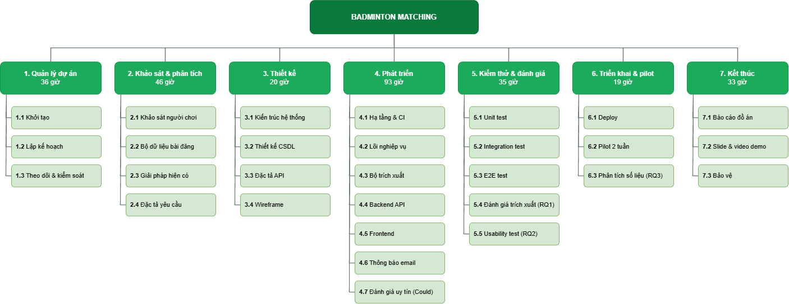

# WBS – CẤU TRÚC PHÂN RÃ CÔNG VIỆC

**Sinh viên thực hiện:** An Đức Mạnh – MSSV 23110310 · Đồ án cá nhân
Phiên bản 1.1 – 13/11/2026 · Phương pháp: phân rã theo **giai đoạn → gói công việc**. Mỗi gói công việc có sản phẩm đầu ra, ước lượng công và mức ưu tiên rõ ràng.

**Ưu tiên (MoSCoW):** M = Must · S = Should · C = Could (chỉ làm nếu còn thời gian)
**Trạng thái:** Xong · Đang làm · Chưa (chưa bắt đầu)

## 1. Sơ đồ tổng quan (cấp 1–2)

Bản vẽ gốc chỉnh sửa được: [diagrams/wbs-tong-quan.drawio](diagrams/wbs-tong-quan.drawio) (mở bằng https://app.diagrams.net hoặc extension Draw.io Integration trong VS Code). Sửa xong thì xuất lại PNG và ghi đè `diagrams/wbs-tong-quan.png`.

## 2. Bảng WBS chi tiết

| Mã | Gói công việc | Sản phẩm đầu ra | Ưu tiên | Giờ công | Phụ thuộc | TT |
|---|---|---|:-:|---:|---|:-:|
| **1** | **QUẢN LÝ DỰ ÁN** | | | **36** | | |
| 1.1.1 | Chốt đề tài chính thức | Tên đề tài, câu hỏi nghiên cứu | M | 4 | – | Xong |
| 1.1.2 | Lập Project Charter | [01-project-charter.md](01-project-charter.md) | M | 8 | 1.1.1 | Xong |
| 1.2.1 | Lập WBS | Tài liệu này | M | 4 | 1.1.2 | Xong |
| 1.2.2 | Lập Gantt chart | [03-gantt.md](03-gantt.md) | M | 3 | 1.2.1 | Xong |
| 1.2.3 | Kế hoạch quản lý rủi ro + kế hoạch chất lượng | `docs/RISKS.md`, `docs/QUALITY.md` | M | 3 | 1.1.2 | Xong |
| 1.3.1 | Nhật ký tiến độ hằng tuần | Weekly log (việc đã làm / kế hoạch / vướng mắc) | M | 8 | – | Đang làm |
| 1.3.2 | Gặp và báo cáo GVHD | Báo cáo 2 tuần/lần | M | 6 | – | Chưa |
| **2** | **KHẢO SÁT & PHÂN TÍCH** | | | **46** | | |
| 2.1.1 | Thiết kế bảng hỏi (kèm phiếu đồng ý) | Google Form | M | 3 | 1.1.2 | Chưa |
| 2.1.2 | Thu thập ≥ 50 phản hồi | Dữ liệu khảo sát | M | 5 | 2.1.1 | Chưa |
| 2.1.3 | Phân tích kết quả khảo sát | Báo cáo khảo sát (D2) | M | 4 | 2.1.2 | Chưa |
| 2.2.1 | Quy trình thu thập & ẩn danh hóa | Hướng dẫn gán nhãn | M | 2 | 1.1.2 | Chưa |
| 2.2.2 | Thu thập ≥ 200 bài đăng | Dữ liệu thô đã ẩn danh | M | 8 | 2.2.1 | Chưa |
| 2.2.3 | Gán nhãn chuẩn (ground truth) + đo độ đồng thuận | Bộ dữ liệu gán nhãn (D3), Cohen's κ | M | 10 | 2.2.2 | Chưa |
| 2.3 | Phân tích giải pháp hiện có | Bảng so sánh | S | 3 | – | Chưa |
| 2.4.1 | User stories + use case (MoSCoW) | Product backlog | M | 6 | 2.1.3 | Chưa |
| 2.4.2 | Đặc tả yêu cầu + quy tắc nghiệp vụ (mã BR-xx) | `docs/project.md` (D4) | M | 5 | 2.4.1 | Đang làm |
| **3** | **THIẾT KẾ** | | | **20** | | |
| 3.1 | Kiến trúc hệ thống (modular monolith) | Sơ đồ kiến trúc trong `docs/project.md` | M | 4 | 2.4.1 | Xong |
| 3.2 | Thiết kế CSDL (MongoDB collections, index) | `docs/database.md` | M | 4 | 3.1 | Xong |
| 3.3 | Đặc tả API (endpoint, định dạng response, mã lỗi) | `docs/API.md` | M | 4 | 3.1 | Xong |
| 3.4 | Wireframe các màn hình chính | Wireframe (Figma / giấy) | M | 8 | 2.4.1 | Chưa |
| **4** | **PHÁT TRIỂN** | | | **93** | | |
| 4.1.1 | Khởi tạo repo, cấu trúc mã nguồn | Repo + TypeScript + Vitest | M | 2 | – | Xong |
| 4.1.2 | Cấu hình CI (GitHub Actions) + quy ước Git/PR | `.github/workflows/ci.yml`, `docs/GIT.md`, PR template | M | 2 | 4.1.1 | Xong |
| 4.1.3 | Khung dự án: `backend/` (Express + MongoDB), `frontend/` (React + Vite) + staging | Ứng dụng chạy được ở local | M | 3 | 3.1 | Đang làm |
| 4.2 | Lõi nghiệp vụ: kèo, chỗ, trình độ | `backend/src/modules/post/post.rules.js` | M | 8 | 4.1.1 | Đang làm |
| 4.3.1 | Bộ trích xuất dựa trên luật (baseline) | `backend/src/modules/parser/` | M | 12 | 4.1.1, 2.2.3 | Đang làm |
| 4.3.2 | Bộ trích xuất bằng LLM | Module LLM | M | 8 | 4.3.1 | Chưa |
| 4.3.3 | Bộ trích xuất hybrid | Module hybrid | M | 5 | 4.3.2 | Chưa |
| 4.4.1 | Xác thực (email + mật khẩu, JWT) | Đăng nhập hoạt động | M | 4 | 4.1.3 | Đang làm |
| 4.4.2 | API kèo + tham gia/rời | API posts | M | 10 | 4.2, 4.4.1 | Đang làm |
| 4.4.3 | Tìm kiếm theo khu vực / ngày / trình độ | API search | M | 8 | 4.4.2 | Đang làm |
| 4.5.1 | Màn hình đăng kèo + dán-tự-điền | UI đăng kèo | M | 12 | 3.4, 4.3.1 | Đang làm |
| 4.5.2 | Danh sách kèo + bộ lọc | UI tìm kèo | M | 10 | 3.4, 4.4.3 | Đang làm |
| 4.5.3 | Trang cá nhân | UI profile | S | 5 | 4.4.1 | Xong |
| 4.6 | Thông báo qua email | Module notify | S | 4 | 4.4.2 | Chưa |
| 4.7 | Đánh giá uy tín sau kèo | API + UI rating | C | *(6)* | 4.4.2 | Chưa |
| **5** | **KIỂM THỬ & ĐÁNH GIÁ** | | | **35** | | |
| 5.1 | Unit test (liên tục, coverage ≥ 80%) | `backend/tests/` (Jest), test frontend (Vitest) | M | 12 | 4.1.2 | Đang làm |
| 5.2 | Integration / API test | Jest + Supertest + MongoDB trong RAM | M | 6 | 4.4.2 | Đang làm |
| 5.3 | E2E test cho 3 luồng chính (đăng, tìm, tham gia) | Bộ test Playwright | S | 5 | 4.5.2 | Chưa |
| 5.4 | Đánh giá bộ trích xuất (RQ1) | Bảng P/R/F1 | M | 6 | 2.2.3, 4.3.3 | Chưa |
| 5.5 | Usability test A/B (RQ2) | Kết quả kiểm định Wilcoxon | M | 6 | 4.5.1 | Chưa |
| **6** | **TRIỂN KHAI & PILOT** | | | **19** | | |
| 6.1 | Deploy production | URL production (D6) | M | 3 | M3 | Chưa |
| 6.2 | Pilot 2 tuần tại Hà Nội | Log hệ thống, phản hồi | M | 12 | 6.1 | Chưa |
| 6.3 | Phân tích số liệu pilot (RQ3) | Thống kê + điểm SUS | M | 4 | 6.2 | Chưa |
| **7** | **KẾT THÚC** | | | **33** | | |
| 7.1 | Viết báo cáo đồ án | Báo cáo (D8) | M | 24 | 5.4, 6.3 | Chưa |
| 7.2 | Slide + video demo | Slide, video (D8) | M | 6 | 6.1 | Chưa |
| 7.3 | Bảo vệ | – | M | 3 | 7.1, 7.2 | Chưa |
| | **TỔNG (không tính mục Could)** | | | **282** | | |

## 3. Tổng hợp khối lượng

| | Giờ công |
|---|---:|
| Tổng kế hoạch (Must + Should) | 282 |
| Đã hoàn thành đến 13/11 (1.1, 1.2.1–1.2.2, 4.1.1–4.1.2, một phần 4.2 / 4.3.1 / 5.1) | ~35 |
| Còn lại | ~247 |
| Số tuần còn lại (14/11/2026 → 29/01/2027) | 11 |
| **Trung bình cần làm** | **~22 giờ/tuần** |
| Có thể cắt nếu chậm (mục *Should*: 2.3, 4.5.3, 4.6, 5.3) | −17 |

Nếu thực tế chỉ có khoảng 15 giờ/tuần thì kế hoạch này không đủ. Khi đó cần chọn một trong hai: (a) cắt hết mục *Should* và giảm pilot xuống 1 tuần, hoặc (b) xin lùi mốc bảo vệ.

## 4. Từ điển WBS (các gói quan trọng)

**2.2 Bộ dữ liệu bài đăng.** Thu thập ≥ 200 bài ghép kèo tiếng Việt, ưu tiên bài do người tham gia khảo sát tự gửi (có đồng ý). Bài chép tay từ group công khai phải xóa tên, SĐT, ảnh và đường dẫn hồ sơ ngay khi chép. Gán nhãn 4 nhóm trường (thời gian, giá, số chỗ, trình độ). Vì làm một mình, độ tin cậy của nhãn được kiểm tra bằng hai cách: (1) nhờ 1 người gán nhãn độc lập 50 bài và tính Cohen's κ giữa hai người (mục tiêu κ ≥ 0,8); (2) tự gán nhãn lại 20% số bài sau 1 tuần để đo độ nhất quán. Chia 70% tập phát triển luật, 30% tập kiểm tra giữ kín.

**4.3 Bộ trích xuất.** Nhận văn bản bài đăng, trả về dữ liệu có cấu trúc để điền form. Ba biến thể: (1) dựa trên luật (regex + từ điển, chạy offline, không tốn chi phí); (2) LLM; (3) hybrid, dùng luật trước và chỉ gọi LLM cho các trường luật không trích được. **Tiêu chí chấp nhận:** đạt chỉ tiêu F1 trong Charter trên tập kiểm tra giữ kín.

**5.1 Unit test.** Mọi logic nghiệp vụ và bộ trích xuất phải có unit test. CI chạy typecheck + test + coverage trên mỗi lần push và Pull Request. Không merge vào `main` khi CI đỏ. Backend dùng Jest + Supertest với MongoDB chạy trong RAM (dạng replica set để test được transaction); frontend dùng Vitest. Ngưỡng coverage backend: lines/functions/statements ≥ 80%, branches ≥ 70%.

**6.2 Pilot.** 2 tuần tại Hà Nội, phối hợp với ít nhất 1 chủ sân hoặc admin group. Ghi log ẩn danh: số kèo đăng, tỉ lệ kèo đủ người, thời gian từ lúc đăng đến lúc đủ người. Kết thúc bằng khảo sát SUS.
