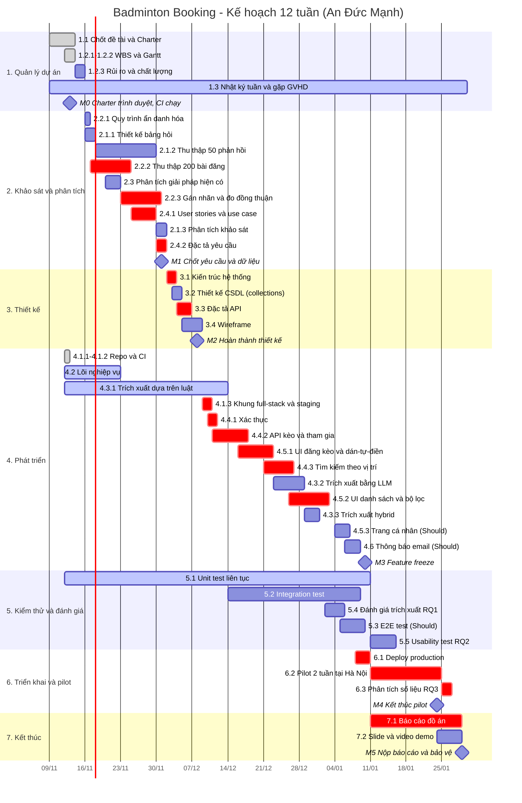

# GANTT CHART – TIẾN ĐỘ ĐỒ ÁN

**Sinh viên thực hiện:** An Đức Mạnh – MSSV 23110310 · Đồ án cá nhân
Phiên bản 1.1 – 13/11/2026 · Thời gian: **12 tuần, 09/11/2026 → 29/01/2027** · Mã công việc khớp với [WBS](02-wbs.md).

> Biểu đồ dùng Mermaid: GitHub hiển thị trực tiếp; trong VS Code cần extension *Markdown Preview Mermaid Support*.
> Vì chỉ có một người làm, các công việc được xếp **gần như nối tiếp nhau**. Những thanh kéo dài (họp, unit test, thu thập khảo sát) là việc làm xen kẽ với cường độ thấp.
> Màu đỏ (`crit`) là các công việc trên **đường găng**.



## Đường găng (critical path)

```
Thu thập + gán nhãn dữ liệu (2.2) → User stories/đặc tả (2.4) → Kiến trúc/API (3.1, 3.3)
→ Staging → Xác thực → API kèo → UI đăng kèo → Tìm kiếm → UI tìm kèo (4.x)
→ M3 → Deploy (6.1) → Pilot (6.2) → Phân tích (6.3) → Báo cáo (7.1) → M5
```

Với một người, gần như mọi công việc phát triển đều nằm trên đường găng, vì không có ai làm song song. Pilot (6.2) cần đủ 2 tuần để có số liệu cho RQ3, nên **M3 (10/01) là mốc không được trễ**.

**Quy tắc cắt phạm vi:** nếu đến **03/01** phần phát triển trễ hơn 3 ngày so với kế hoạch, bỏ theo thứ tự: 4.6 Thông báo email → 4.5.3 Trang cá nhân → 5.3 E2E test. Mục 4.7 Uy tín (*Could*) không có trong lịch, chỉ làm nếu còn thời gian.

## Lịch theo tuần

| Tuần | Thời gian | Trọng tâm | Giờ dự kiến | Mốc |
|---|---|---|---:|---|
| 1 | 09/11 – 15/11 | Chốt đề tài, Charter, WBS, Gantt, repo + CI, lõi nghiệp vụ | ~35 *(đã làm phần lớn)* | **M0** (13/11) |
| 2 | 16/11 – 22/11 | Bảng hỏi, thu thập bài đăng, phân tích giải pháp hiện có | ~20 | |
| 3 | 23/11 – 29/11 | Gán nhãn dữ liệu, user stories | ~22 | |
| 4 | 30/11 – 06/12 | Phân tích khảo sát, đặc tả yêu cầu, kiến trúc, thiết kế CSDL, API | ~22 | **M1** (01/12) |
| 5 | 07/12 – 13/12 | Wireframe, staging, xác thực, bắt đầu API kèo | ~22 | **M2** (08/12) |
| 6 | 14/12 – 20/12 | API kèo, UI đăng kèo, integration test | ~24 | |
| 7 | 21/12 – 27/12 | Tìm kiếm vị trí, trích xuất LLM, UI danh sách | ~24 | |
| 8 | 28/12 – 03/01 | UI danh sách, hybrid, đánh giá RQ1 · *nghỉ Tết Dương lịch 01/01* | ~20 | |
| 9 | 04/01 – 10/01 | Trang cá nhân, email, E2E, deploy production | ~24 | **M3** (10/01) |
| 10 | 11/01 – 17/01 | Pilot tuần 1, usability test, viết báo cáo | ~22 | |
| 11 | 18/01 – 24/01 | Pilot tuần 2, viết báo cáo | ~20 | **M4** (24/01) |
| 12 | 25/01 – 29/01 | Phân tích pilot, hoàn thiện báo cáo, slide | ~20 | **M5** (29/01) |

*Các ngày trên là kế hoạch ban đầu. Cần điều chỉnh khi có lịch thi và lịch bảo vệ chính thức của khoa.*
