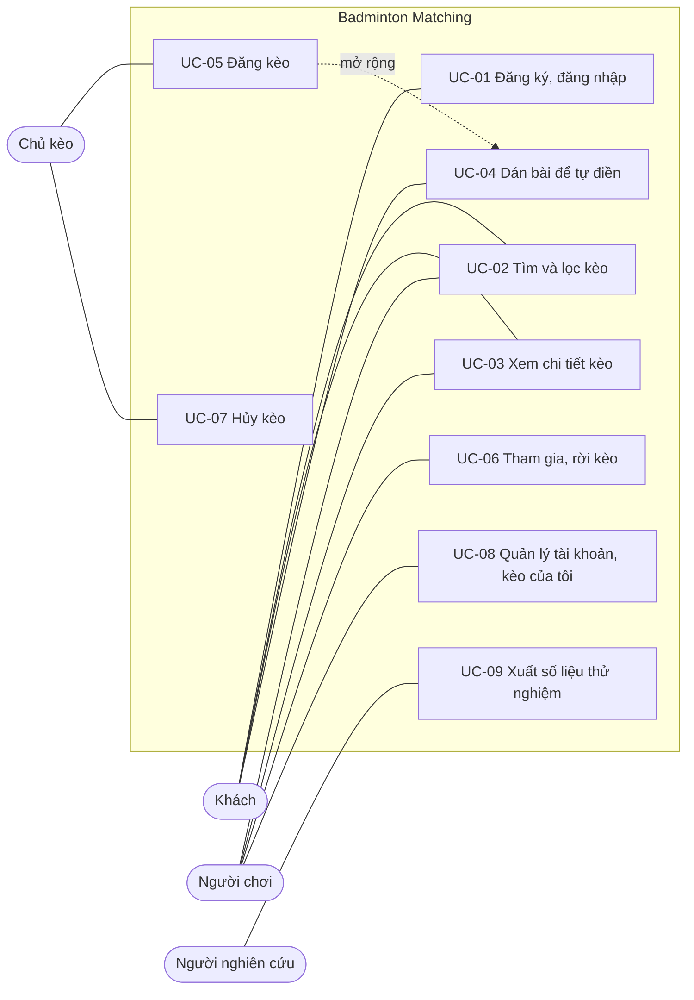

# User stories và use case — Badminton Matching

**Sinh viên thực hiện:** An Đức Mạnh – MSSV 23110310 · Đồ án cá nhân
Phiên bản 1.0 – 23/11/2026 · Mã WBS: **2.4.1** (product backlog). Phạm vi và mức ưu tiên lấy từ [Charter](01-project-charter.md) mục 5; quy tắc nghiệp vụ BR-xx và chức năng F-xx ở [project.md](project.md).

## 1. Cách đọc

- **Tiêu chí chấp nhận (AC):** điều kiện kiểm tra được; story chỉ "Xong" khi mọi AC đạt và có test hoặc ca kiểm tra trong [QUALITY.md](QUALITY.md).
- **Mức ưu tiên (MoSCoW):** **M**ust: thiếu thì đồ án không đạt · **S**hould: nên có, cắt khi trễ · **C**ould: chỉ làm khi dư thời gian · **W**on't: không làm trong đồ án.
- **Trạng thái:** Xong · Đang làm · Chưa. Khi kết quả khảo sát (WBS 2.1.3) cho thấy nhu cầu khác, cập nhật mức ưu tiên tại đây và ghi vào mục 6.

## 2. Vai trò

| Vai trò | Mô tả | Nhu cầu chính |
|---|---|---|
| **Khách** | Chưa đăng nhập, vừa nghe tới nền tảng qua link được chia sẻ | Xem nhanh có kèo nào gần, hợp giờ mà không phải tạo tài khoản |
| **Người chơi vãng lai** | Đã đăng nhập; chơi 1–3 buổi / tuần, không có nhóm cố định | Tìm kèo đúng khu vực, đúng giờ, **đúng trình độ**; biết chắc mình có chỗ |
| **Chủ kèo** | Người chơi đã thuê sân và cần thêm người (thường thiếu 1–4 người, sát giờ) | Đăng tuyển nhanh, không phải gõ lại bài đã viết trên Facebook; biết ai đã nhận chỗ nam / nữ |
| **Người nghiên cứu** | Sinh viên thực hiện đồ án | Có số liệu sạch để trả lời RQ1–RQ3 |

## 3. Danh sách user story

### E1 — Tìm kèo

| Mã | User story | AC | Mức | Liên kết | Trạng thái |
|---|---|---|:-:|---|---|
| US-06 | Là **khách**, tôi muốn xem danh sách kèo sắp diễn ra mà không cần đăng nhập để biết nền tảng có kèo hợp với mình không. | Chỉ hiện kèo chưa bắt đầu và chưa bị hủy, sớm nhất lên trước; mỗi kèo có giờ, sân, khu vực, số chỗ còn, trình độ, giá. | M | F3 | Xong |
| US-07 | Là **người chơi**, tôi muốn lọc theo khu vực và ngày để chỉ thấy kèo mình đi được. | Ngày tính theo giờ Việt Nam ([RISKS.md](RISKS.md) R11); bộ lọc nằm trên URL nên gửi link hoặc tải lại trang vẫn giữ. | M | F3 | Xong |
| US-08 | Là **người chơi**, tôi muốn chỉ xem kèo hợp trình độ của mình để không bị từ chối khi tham gia. | Kèo hiện ra có khoảng trình độ chứa trình độ trong hồ sơ (BR-09). | M | F3 | Xong |
| US-09 | Là **người chơi**, tôi muốn xem chi tiết kèo, gồm số chỗ còn cho nam, nữ, chung và danh sách người đã tham gia, để quyết định có vào không. | Không hiện email của ai; hiện rõ "Còn N chỗ / Đủ người / Đã hủy". | M | F5 | Xong |
| US-10 | Là **người chơi**, tôi muốn tìm kèo gần vị trí hiện tại để đi lại nhanh. | Sắp xếp theo khoảng cách tới sân; cần tọa độ sân. | C | Charter 5.1 | Chưa |

### E2 — Đăng kèo và trích xuất bài đăng

| Mã | User story | AC | Mức | Liên kết | Trạng thái |
|---|---|---|:-:|---|---|
| US-11 | Là **chủ kèo**, tôi muốn đăng kèo gồm sân, khu vực, thời gian, trình độ, chi phí và số chỗ theo giới tính để tuyển đúng người còn thiếu. | Giờ bắt đầu ở tương lai; thời lượng ≤ 6 giờ; trình độ từ ≤ trình độ đến; giá 0 – 1.000.000đ; tổng 1 – 20 chỗ (BR-01 → BR-05); lỗi chỉ rõ ô sai. | M | F4 | Xong |
| US-12 | Là **chủ kèo**, tôi muốn dán bài tuyển người đã viết sẵn (như trên Facebook) để form tự điền, khỏi gõ lại. | Nhận ra thời gian, giá, số chỗ nam / nữ / chung, trình độ; ô tự điền có nền vàng và sửa được; không nhận ra gì thì báo và cho điền tay; khách cũng dùng thử được. | M | F4 | Xong (dựa trên luật) |
| US-13 | Là **chủ kèo**, tôi muốn phần tự điền đúng cả với bài viết tắt, sai chính tả, nhiều cách ghi giờ để ít phải sửa tay. | Phương pháp kết hợp (luật + LLM) đạt F1 trung bình ≥ 0,90 trên 30 bài kiểm tra (RQ1, H1); LLM lỗi hoặc quá 5 giây thì dùng kết quả của luật; không gửi tên, số điện thoại sang dịch vụ LLM. | M | F7, WBS 4.3.2–4.3.3 | Chưa |
| US-14 | Là **chủ kèo**, tôi muốn chia sẻ link kèo lên Facebook / Zalo để người trong nhóm cũ vào tham gia. | Nút chia sẻ mở hộp chia sẻ; link mở thẳng trang chi tiết kèo. | S | Charter 5.1 | Chưa |

### E3 — Tham gia kèo

| Mã | User story | AC | Mức | Liên kết | Trạng thái |
|---|---|---|:-:|---|---|
| US-15 | Là **người chơi**, tôi muốn bấm một nút để tham gia kèo và được giữ chỗ ngay, không phải nhắn tin chờ chủ kèo trả lời. | Chỉ kèo `open`, chưa bắt đầu (BR-06); không tự tham gia kèo của mình (BR-07); mỗi người một lần (BR-08); đúng trình độ (BR-09); dùng chỗ đúng giới tính trước, hết thì dùng chỗ chung (BR-10); hết chỗ thì kèo tự chuyển "đủ người" (BR-11); **nhiều người bấm cùng lúc không vượt số chỗ**. | M | F5 | Xong |
| US-16 | Là **người chơi**, tôi muốn rời kèo trước giờ chơi khi có việc bận để chỗ được trả lại cho người khác. | Chỉ trước giờ bắt đầu; kèo đang "đủ người" mở lại; trả đúng loại chỗ đã lấy (BR-12). | M | F5 | Xong |
| US-17 | Là **chủ kèo**, tôi muốn hủy kèo khi không thuê được sân để người đã nhận chỗ biết sớm. | Chỉ chủ kèo, chỉ trước giờ bắt đầu; kèo hủy ẩn khỏi danh sách, không ai tham gia hay rời được (BR-13); có hỏi xác nhận trước khi hủy. | M | F5 | Xong |

### E4 — Kèo của tôi

| Mã | User story | AC | Mức | Liên kết | Trạng thái |
|---|---|---|:-:|---|---|
| US-18 | Là **người chơi**, tôi muốn xem các kèo mình đã đăng và đã tham gia ở một chỗ để nắm lịch chơi. | Hai tab "Đã tham gia", "Đã đăng" có số lượng; kèo đã qua ghi "Đã diễn ra"; trang Tổng quan có số kèo sắp diễn ra. | M | F6 | Xong |

### E5 — Thông báo

| Mã | User story | AC | Mức | Liên kết | Trạng thái |
|---|---|---|:-:|---|---|
| US-19 | Là **chủ kèo**, tôi muốn nhận email khi có người tham gia hoặc rời kèo để không phải mở trang liên tục. | Gửi trong vòng 1 phút; lỗi gửi email không làm hỏng thao tác tham gia. | S | F8, WBS 4.6 | Chưa |
| US-20 | Là **người chơi**, tôi muốn nhận email nhắc trước giờ chơi để không quên kèo. | Gửi khoảng 2 giờ trước giờ bắt đầu, chỉ cho kèo chưa hủy. | S | F8, WBS 4.6 | Chưa |

### E6 — Uy tín

| Mã | User story | AC | Mức | Liên kết | Trạng thái |
|---|---|---|:-:|---|---|
| US-21 | Là **người chơi**, tôi muốn đánh giá những người cùng kèo sau buổi chơi (có đến không, trình độ có đúng không) để lần sau chọn kèo tin cậy hơn. | Chỉ người cùng kèo, chỉ sau giờ kết thúc, mỗi người một lần. | C | F9, WBS 4.7 | Chưa |

### E7 — Số liệu cho nghiên cứu

| Mã | User story | AC | Mức | Liên kết | Trạng thái |
|---|---|---|:-:|---|---|
| US-22 | Là **người nghiên cứu**, tôi muốn xuất số liệu kèo trong thời gian thử nghiệm để kiểm định H3 (≥ 60% kèo đủ người trước giờ chơi). | Mỗi kèo có thời điểm đăng, giờ chơi, trạng thái, số chỗ, thời điểm từng người tham gia; xuất ra CSV không chứa email hay tên; loại tài khoản thử (`@smoke.local`). | M | RQ3, WBS 6.3 | Đang làm (đã lưu đủ dữ liệu, chưa có lệnh xuất) |
| US-23 | Là **người nghiên cứu**, tôi muốn biết mỗi kèo được tạo bằng dán bài hay điền tay, và người dùng phải sửa bao nhiêu ô tự điền, để đánh giá tính năng dán bài trong sử dụng thật. | Lưu nội dung bài đã dán (`rawText`) và danh sách ô bị sửa sau khi tự điền; không ảnh hưởng thao tác đăng kèo. | S | RQ1, RQ2 | Chưa (mới lưu `rawText`) |

### Ngoài phạm vi (Won't)

Theo [Charter](01-project-charter.md) mục 5.2: tự động thu thập bài từ Facebook; thanh toán trực tuyến và đặt sân với chủ sân; chat thời gian thực (dùng link Zalo / Messenger); thông báo đẩy trên trình duyệt; app di động (giai đoạn 2).

## 4. Tổng hợp

| Mức | Số story | Xong | Đang làm | Chưa |
|---|:-:|:-:|:-:|:-:|
| Must | 16 | 14 | 1 (US-22) | 1 (US-13) |
| Should | 4 | 0 | 0 | 4 (US-14, US-19, US-20, US-23) |
| Could | 3 | 0 | 0 | 3 (US-05, US-10, US-21) |
| **Tổng** | **23** | **14** | **1** | **8** |

Hai story **Must** còn lại nằm trên đường găng: **US-13** (bộ trích xuất LLM và kết hợp, trước M2 30/11) và **US-22** (xuất số liệu thử nghiệm, trước 6.3 ngày 08/12).

## 5. Use case

### 5.1 Sơ đồ

"Chủ kèo" là người chơi đã đăng kèo đó, nên có mọi use case của người chơi. UC-04 dùng được độc lập (khách dùng thử) hoặc là bước tùy chọn của UC-05.

### 5.2 Đặc tả các use case chính

**UC-05 Đăng kèo (kèm UC-04 Dán bài để tự điền)**

| Mục | Nội dung |
|---|---|
| Tác nhân | Chủ kèo (đã đăng nhập) |
| Tiền điều kiện | Đã đăng nhập; chưa đăng nhập thì được chuyển tới Đăng nhập rồi quay lại |
| Luồng chính | 1. Mở "Đăng kèo". 2. Dán bài viết sẵn, bấm "Tự điền". 3. Hệ thống trích xuất, điền các ô nhận ra được và tô vàng. 4. Chủ kèo kiểm tra, sửa, bổ sung tên sân và khu vực. 5. Bấm "Đăng kèo". 6. Hệ thống kiểm tra BR-01 → BR-05, lưu kèo trạng thái `open`, chuyển tới trang chi tiết. |
| Luồng phụ | 2a. Không dán bài: điền tay toàn bộ form. 3a. Không nhận ra thông tin nào: báo "Không nhận ra thông tin nào", giữ nguyên form. 6a. Vi phạm quy tắc: báo lỗi dưới đúng ô, không lưu. |
| Hậu điều kiện | Kèo xuất hiện trong danh sách; `rawText` được lưu để đánh giá bộ trích xuất. |
| Story | US-11, US-12, US-13 |

**UC-06 Tham gia, rời kèo**

| Mục | Nội dung |
|---|---|
| Tác nhân | Người chơi (đã đăng nhập, không phải chủ kèo) |
| Tiền điều kiện | Kèo `open`, chưa bắt đầu; người chơi đã có giới tính và trình độ trong hồ sơ |
| Luồng chính | 1. Mở chi tiết kèo. 2. Bấm "Tham gia kèo". 3. Hệ thống, trong một transaction, kiểm tra BR-06 → BR-10, chọn chỗ đúng giới tính hoặc chỗ chung, thêm người chơi. 4. Hết chỗ thì kèo chuyển `full` (BR-11). 5. Trang hiện tên người chơi trong danh sách, nút đổi thành "Rời kèo". |
| Luồng phụ | 3a. Lệch trình độ: 409 `LEVEL_MISMATCH`. 3b. Hết chỗ phù hợp (kể cả do người khác vừa lấy cùng lúc): 409 `NO_SLOT` / `POST_NOT_OPEN`. 3c. Phiên hết hạn: tự đăng xuất, báo đăng nhập lại. R1. Rời kèo trước giờ chơi: trả lại đúng loại chỗ, kèo `full` mở lại (BR-12). |
| Hậu điều kiện | Số chỗ còn và trạng thái kèo luôn đúng, kể cả khi nhiều người bấm cùng lúc (TC-Q1-01, TC-Q1-08). |
| Story | US-15, US-16 |

**UC-07 Hủy kèo**

| Mục | Nội dung |
|---|---|
| Tác nhân | Chủ kèo |
| Tiền điều kiện | Kèo của chính mình, chưa bắt đầu, chưa hủy |
| Luồng chính | 1. Mở chi tiết kèo. 2. Bấm "Hủy kèo", xác nhận. 3. Hệ thống chuyển kèo sang `closed`, ẩn khỏi danh sách. |
| Luồng phụ | 2a. Người khác gọi API hủy: 403 `NOT_AUTHOR`. 2b. Kèo đã bắt đầu: 409 `POST_STARTED`. |
| Story | US-17 |

## 6. Lịch sử thay đổi

| Ngày | Thay đổi |
|---|---|
| 23/11/2026 | Phiên bản đầu: 23 story từ phạm vi Charter và các chức năng đã làm; sẽ xem lại mức ưu tiên sau khi phân tích khảo sát (WBS 2.1.3, dự kiến 01–02/12) |
