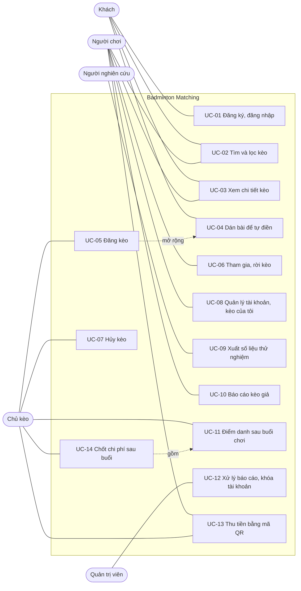

# User stories và use case — Badminton Matching

**Sinh viên thực hiện:** An Đức Mạnh – MSSV 23110310 · Đồ án cá nhân
Phiên bản 1.2 – 24/11/2026 · Mã WBS: **2.4.1** (product backlog). Phạm vi và mức ưu tiên lấy từ [Charter](01-project-charter.md) mục 5; quy tắc nghiệp vụ BR-xx và chức năng F-xx ở [project.md](project.md).

## 1. Cách đọc

- **Tiêu chí chấp nhận (AC):** điều kiện kiểm tra được; story chỉ "Xong" khi mọi AC đạt và có test hoặc ca kiểm tra trong [QUALITY.md](QUALITY.md).
- **Mức ưu tiên (MoSCoW):** **M**ust: thiếu thì đồ án không đạt · **S**hould: nên có, cắt khi trễ · **C**ould: chỉ làm khi dư thời gian · **W**on't: không làm trong đồ án.
- **Trạng thái:** Xong · Đang làm · Chưa. Khi kết quả khảo sát (WBS 2.1.3) cho thấy nhu cầu khác, cập nhật mức ưu tiên tại đây và ghi vào mục 6.

## 2. Vai trò

| Vai trò | Mô tả | Nhu cầu chính |
|---|---|---|
| **Khách** | Chưa đăng nhập, vừa nghe tới nền tảng qua link được chia sẻ | Xem nhanh có kèo nào gần, hợp giờ mà không phải tạo tài khoản |
| **Người chơi vãng lai** | Đã đăng nhập; chơi 1–3 buổi / tuần, không có nhóm cố định | Tìm kèo đúng khu vực, đúng giờ, **đúng trình độ**; biết chắc mình có chỗ |
| **Chủ kèo** | Người chơi đã thuê sân và cần thêm người (thường thiếu 1–4 người, sát giờ) | Đăng tuyển nhanh, không phải gõ lại bài đã viết trên Facebook; biết ai đã nhận chỗ nam / nữ |
| **Người nghiên cứu** | Sinh viên thực hiện đồ án | Có số liệu sạch để trả lời RQ1–RQ3 |
| **Quản trị viên** | Trong thời gian đồ án, chính là người nghiên cứu | Xử lý kèo bị báo cáo, khóa tài khoản vi phạm (E8) |

## 3. Danh sách user story

### E1 — Tìm kèo

| Mã | User story | AC | Mức | Liên kết | Trạng thái |
|---|---|---|:-:|---|---|
| US-06 | Là **khách**, tôi muốn xem danh sách kèo sắp diễn ra mà không cần đăng nhập để biết nền tảng có kèo hợp với mình không. | Chỉ hiện kèo chưa bắt đầu và chưa bị hủy, sớm nhất lên trước; mỗi kèo có giờ, sân, khu vực, số chỗ còn, trình độ, giá. | M | F3 | Xong |
| US-07 | Là **người chơi**, tôi muốn lọc theo khu vực và ngày để chỉ thấy kèo mình đi được. | Ngày tính theo giờ Việt Nam ([RISKS.md](RISKS.md) R11); bộ lọc nằm trên URL nên gửi link hoặc tải lại trang vẫn giữ. | M | F3 | Xong |
| US-08 | Là **người chơi**, tôi muốn chỉ xem kèo hợp trình độ của mình để không bị từ chối khi tham gia. | Kèo hiện ra có khoảng trình độ chứa trình độ trong hồ sơ (BR-09). | M | F3 | Xong |
| US-09 | Là **người chơi**, tôi muốn xem chi tiết kèo, gồm số chỗ còn cho nam, nữ, chung và danh sách người đã tham gia, để quyết định có vào không. | Không hiện email của ai; hiện rõ "Còn N chỗ / Đủ người / Đã hủy". | M | F5 | Xong |
| US-10 | Là **người chơi**, tôi muốn tìm kèo gần vị trí hiện tại để đi lại nhanh. | Sắp xếp theo khoảng cách tới sân; cần tọa độ sân. | C | Charter 5.1 | Chưa |

### E2 — Đăng kèo và trích xuất bài đăng

| Mã | User story | AC | Mức | Liên kết | Trạng thái |
|---|---|---|:-:|---|---|
| US-11 | Là **chủ kèo**, tôi muốn đăng kèo gồm sân, khu vực, thời gian, trình độ, chi phí và số chỗ theo giới tính để tuyển đúng người còn thiếu. | Giờ bắt đầu ở tương lai; thời lượng ≤ 6 giờ; trình độ từ ≤ trình độ đến; giá 0 – 1.000.000đ; tổng 1 – 20 chỗ (BR-01 → BR-05); lỗi chỉ rõ ô sai. | M | F4 | Xong |
| US-12 | Là **chủ kèo**, tôi muốn dán bài tuyển người đã viết sẵn (như trên Facebook) để form tự điền, khỏi gõ lại. | Nhận ra thời gian, giá, số chỗ nam / nữ / chung, trình độ; ô tự điền có nền vàng và sửa được; không nhận ra gì thì báo và cho điền tay; khách cũng dùng thử được. | M | F4 | Xong (dựa trên luật) |
| US-13 | Là **chủ kèo**, tôi muốn phần tự điền đúng cả với bài viết tắt, sai chính tả, nhiều cách ghi giờ để ít phải sửa tay. | Bộ trích xuất dựa trên luật đạt F1 trung bình ≥ 0,75 trên 30 bài kiểm tra, không nhóm trường nào dưới 0,60 (RQ1, H1); luật được tinh chỉnh theo phân tích lỗi trên 70 bài phát triển. (Phương án LLM / hybrid đã bỏ ngày 24/11/2026.) | M | WBS 4.3.1, 5.4 | Đang làm |
| US-14 | Là **chủ kèo**, tôi muốn chia sẻ link kèo lên Facebook / Zalo để người trong nhóm cũ vào tham gia. | Nút chia sẻ mở hộp chia sẻ; link mở thẳng trang chi tiết kèo. | S | WBS 4.8.4 (làm cùng US-35) | Chưa |

### E3 — Tham gia kèo

| Mã | User story | AC | Mức | Liên kết | Trạng thái |
|---|---|---|:-:|---|---|
| US-15 | Là **người chơi**, tôi muốn bấm một nút để tham gia kèo và được giữ chỗ ngay, không phải nhắn tin chờ chủ kèo trả lời. | Chỉ kèo `open`, chưa bắt đầu (BR-06); không tự tham gia kèo của mình (BR-07); mỗi người một lần (BR-08); đúng trình độ (BR-09); dùng chỗ đúng giới tính trước, hết thì dùng chỗ chung (BR-10); hết chỗ thì kèo tự chuyển "đủ người" (BR-11); **nhiều người bấm cùng lúc không vượt số chỗ**. | M | F5 | Xong |
| US-16 | Là **người chơi**, tôi muốn rời kèo trước giờ chơi khi có việc bận để chỗ được trả lại cho người khác. | Chỉ trước giờ bắt đầu; kèo đang "đủ người" mở lại; trả đúng loại chỗ đã lấy (BR-12). | M | F5 | Xong |
| US-17 | Là **chủ kèo**, tôi muốn hủy kèo khi không thuê được sân để người đã nhận chỗ biết sớm. | Chỉ chủ kèo, chỉ trước giờ bắt đầu; kèo hủy ẩn khỏi danh sách, không ai tham gia hay rời được (BR-13); có hỏi xác nhận trước khi hủy. | M | F5 | Xong |

### E4 — Kèo của tôi

| Mã | User story | AC | Mức | Liên kết | Trạng thái |
|---|---|---|:-:|---|---|
| US-18 | Là **người chơi**, tôi muốn xem các kèo mình đã đăng và đã tham gia ở một chỗ để nắm lịch chơi. | Hai tab "Đã tham gia", "Đã đăng" có số lượng; kèo đã qua ghi "Đã diễn ra"; trang Tổng quan có số kèo sắp diễn ra. | M | F6 | Xong |

### E5 — Thông báo

| Mã | User story | AC | Mức | Liên kết | Trạng thái |
|---|---|---|:-:|---|---|
| US-19 | Là **chủ kèo**, tôi muốn nhận email khi có người tham gia hoặc rời kèo để không phải mở trang liên tục. | Gửi trong vòng 1 phút; lỗi gửi email không làm hỏng thao tác tham gia. | S | F8, WBS 4.6 | Chưa |
| US-20 | Là **người chơi**, tôi muốn nhận email nhắc trước giờ chơi để không quên kèo. | Gửi khoảng 2 giờ trước giờ bắt đầu, chỉ cho kèo chưa hủy. | S | F8, WBS 4.6 | Chưa |

### E6 — Uy tín

| Mã | User story | AC | Mức | Liên kết | Trạng thái |
|---|---|---|:-:|---|---|
| US-21 | Là **người chơi**, tôi muốn đánh giá những người cùng kèo sau buổi chơi (có đến không, trình độ có đúng không) để lần sau chọn kèo tin cậy hơn. | Chỉ người cùng kèo, chỉ sau giờ kết thúc, mỗi người một lần. | C | F9, WBS 4.7 | Chưa |

### E7 — Số liệu cho nghiên cứu

| Mã | User story | AC | Mức | Liên kết | Trạng thái |
|---|---|---|:-:|---|---|
| US-22 | Là **người nghiên cứu**, tôi muốn xuất số liệu kèo trong thời gian thử nghiệm để kiểm định H3 (≥ 60% kèo đủ người trước giờ chơi). | Mỗi kèo có thời điểm đăng, giờ chơi, trạng thái, số chỗ, thời điểm từng người tham gia; xuất ra CSV không chứa email hay tên; loại tài khoản thử (`@smoke.local`). | M | RQ3, WBS 6.3 | Đang làm (đã lưu đủ dữ liệu, chưa có lệnh xuất) |
| US-23 | Là **người nghiên cứu**, tôi muốn biết mỗi kèo được tạo bằng dán bài hay điền tay, và người dùng phải sửa bao nhiêu ô tự điền, để đánh giá tính năng dán bài trong sử dụng thật. | Lưu nội dung bài đã dán (`rawText`) và danh sách ô bị sửa sau khi tự điền; không ảnh hưởng thao tác đăng kèo. | S | RQ1, RQ2 | Chưa (mới lưu `rawText`) |

### E8 — Chống spam và kèo giả

Nền tảng mở cho mọi người đăng kèo nên có thể bị: đăng hàng loạt kèo để quảng cáo, kèo "ma" không có sân thật, tạo nhiều tài khoản ảo để giữ chỗ. Kèo giả còn làm **sai số liệu RQ3** (tỉ lệ kèo đủ người). Cách xử lý theo 3 lớp: **chặn trước** (giới hạn), **cộng đồng phát hiện** (báo cáo), **quản trị xử lý** (ẩn kèo, khóa tài khoản).

| Mã | User story | AC | Mức | Liên kết | Trạng thái |
|---|---|---|:-:|---|---|
| US-24 | Là **người chơi**, tôi muốn hệ thống chặn việc đăng kèo hàng loạt để danh sách không bị ngập kèo rác. | Mỗi tài khoản tối đa **3 kèo đang mở** và **5 kèo / ngày**; không cho đăng kèo **trùng** (cùng người, cùng sân, giờ bắt đầu cách nhau dưới 1 giờ); vượt giới hạn báo rõ lý do bằng tiếng Việt; giới hạn tạo tài khoản 10 / giờ / IP (đã có). | S | Quy tắc mới (BR-18) | Một phần (mới có giới hạn tạo tài khoản) |
| US-25 | Là **người chơi**, tôi muốn báo cáo một kèo có dấu hiệu giả để quản trị viên kiểm tra. | Nút "Báo cáo" ở trang chi tiết, chọn lý do (kèo giả / sai thông tin / quảng cáo / lừa đảo, thu tiền trước) và ghi chú ngắn; mỗi người báo một kèo một lần; kèo bị **3 người khác nhau** báo cáo thì **tạm ẩn** khỏi danh sách cho tới khi quản trị viên xem; chủ kèo không thấy ai đã báo cáo. | S | Quy tắc mới (BR-19) | Chưa |
| US-26 | Là **quản trị viên**, tôi muốn xem danh sách kèo bị báo cáo, ẩn kèo vi phạm và khóa tài khoản đăng kèo giả. | Danh sách báo cáo mới nhất trước, kèm lý do và lịch sử của chủ kèo; ẩn hoặc khôi phục kèo; khóa tài khoản thì mọi phiên đăng nhập cũ hết hiệu lực ngay (dùng `tokenVersion` sẵn có) và không đăng nhập lại được; mọi thao tác được ghi lại (ai, lúc nào, lý do). Bản tối thiểu: lệnh quản trị chạy trên máy chủ. | S | Vai trò mới | Chưa |
| US-27 | Là **người chơi**, tôi muốn chỉ tài khoản đã xác minh email mới được đăng kèo để giảm tài khoản ảo. | Đăng ký xong nhận email chứa link xác minh (hết hạn sau 24 giờ); chưa xác minh vẫn xem và tham gia được nhưng không đăng kèo được. | C | Cần F8 (email) | Chưa |

### E9 — Người chơi nhận chỗ nhưng không đến (bùng kèo)

"Bùng kèo" làm chủ kèo thiếu người sát giờ và phải chia thêm tiền sân. Cách xử lý: **nhắc trước** để giảm quên, **ghi nhận sau buổi chơi** bằng điểm danh, **công khai độ tin cậy** để chủ kèo tự cân nhắc, và **hạn chế** người bùng nhiều lần. Số liệu điểm danh đồng thời cho biết kèo có **thực sự diễn ra** không, giúp đánh giá RQ3 chính xác hơn.

| Mã | User story | AC | Mức | Liên kết | Trạng thái |
|---|---|---|:-:|---|---|
| US-28 | Là **chủ kèo**, tôi muốn điểm danh người tham gia sau buổi chơi để ghi nhận ai đã không đến. | Từ giờ kết thúc tới **24 giờ sau**, chủ kèo đánh dấu từng người "Có đến / Không đến" (mặc định "Có đến"); người bị đánh dấu "Không đến" được báo và có thể **phản hồi** nếu đánh dấu sai (chuyển cho quản trị viên); người tham gia cũng có thể báo "**Kèo không diễn ra**", tính như một báo cáo kèo giả (US-25). Phần đánh dấu có mặt làm chung màn hình với chốt chi phí (US-33). | S | WBS 4.8.2 (đánh dấu có mặt), 4.7 (phản hồi), RQ3 | Một phần (điểm danh làm cùng chốt chi phí; chưa có phản hồi khi bị đánh dấu sai) |
| US-29 | Là **chủ kèo**, tôi muốn thấy độ tin cậy của người tham gia để biết ai thường đến đúng hẹn. | Hồ sơ và danh sách người tham gia hiện "đã chơi N kèo · có mặt X%"; chỉ hiện khi đã có ít nhất **3 kèo được điểm danh**, tránh đánh giá oan người mới; không hiện ai đã đánh dấu. | C | WBS 4.7, cùng nhóm US-21 | Chưa |
| US-30 | Là **chủ kèo**, tôi muốn người hay bùng kèo bị hạn chế để kèo của tôi ít bị thiếu người phút chót. | **2 lần "Không đến" trong 30 ngày** thì tạm không tham gia kèo mới trong **7 ngày**; khi bấm tham gia thấy rõ lý do và ngày được mở lại; lần đánh dấu đã được quản trị viên gỡ (US-28 phản hồi) thì không tính. | C | Quy tắc mới (BR-20) | Chưa |
| US-31 | Là **chủ kèo**, tôi muốn biết khi có người rời kèo sát giờ để kịp tìm người thay. | Rời trong vòng **2 giờ trước giờ bắt đầu** được ghi là "rời sát giờ" (tính vào độ tin cậy như nửa lần không đến); chủ kèo nhận email ngay (cùng cơ chế US-19); kèo mở lại chỗ như bình thường (BR-12). | C | F8, BR-12 | Chưa |

Biện pháp **đã có hoặc đã lên kế hoạch** cũng giúp giảm bùng kèo: email nhắc trước giờ chơi (US-20), rời kèo dễ dàng để trả chỗ sớm thay vì im lặng không đến (US-16).

**Quy tắc nghiệp vụ mới đề xuất** (thêm vào [project.md](project.md) mục 6 khi làm): **BR-18** giới hạn và chống trùng khi đăng kèo (US-24) · **BR-19** kèo bị 3 người báo cáo thì tạm ẩn (US-25) · **BR-20** tạm hạn chế tham gia sau 2 lần không đến trong 30 ngày (US-30). BR-14 → BR-17 đã dùng cho thu tiền và chốt chi phí ([project.md](project.md)).

### E10 — Thu tiền và chi phí kèo

Chủ kèo vãng lai thường phải tự thu tiền người lạ, nhắc nợ, và chịu thiệt khi có người bùng kèo. Nhóm này giúp **ghép kèo xong thì lo luôn phần tiền**. Hệ thống **chỉ hiển thị mã QR chuyển khoản** theo chuẩn VietQR; tiền đi thẳng giữa hai tài khoản ngân hàng, hệ thống không giữ tiền ([Charter](01-project-charter.md) mục 5.2).

| Mã | User story | AC | Mức | Liên kết | Trạng thái |
|---|---|---|:-:|---|---|
| US-32 | Là **người chơi đã tham gia kèo**, tôi muốn quét mã QR để chuyển đúng số tiền cho chủ kèo mà không phải hỏi số tài khoản. | Chủ kèo lưu ngân hàng, số tài khoản, tên chủ tài khoản trong hồ sơ (chỉ người đã tham gia kèo mới thấy); trang chi tiết kèo hiện mã QR VietQR có **đúng giá mỗi người** và nội dung chuyển khoản gồm mã kèo; hiện tên chủ tài khoản để đối chiếu; chủ kèo chưa nhập số tài khoản thì ẩn mã QR và nhắc chủ kèo; chủ kèo đánh dấu "Đã trả" cho từng người, người chơi thấy trạng thái của mình. | S | WBS 4.8.1, BR-14, BR-15, R7 | Xong |
| US-33 | Là **chủ kèo**, tôi muốn nhập chi phí thực tế sau buổi chơi (tiền sân, cầu, nước) và đánh dấu ai có mặt để chia lại cho đúng. | Mở được từ giờ bắt đầu tới 24 giờ sau giờ kết thúc; nhập từng khoản bằng bàn phím số; chủ kèo nhập **tổng số người chơi trong buổi** (mặc định = người có mặt + 1, gồm cả bạn không dùng app); mỗi người = tổng ÷ số người, làm tròn lên 1.000đ; chủ kèo chọn mỗi lần chốt người vắng có phải trả không; mã QR của US-32 cập nhật theo số tiền mới; người "Không đến" không bị chia tiền và được ghi nhận cho E9. | S | WBS 4.8.2, US-28, BR-16, BR-17 | Xong |
| US-34 | Là **người chơi**, tôi muốn thêm trang web vào màn hình chính điện thoại để mở nhanh như một ứng dụng. | Trình duyệt hiện gợi ý "Thêm vào màn hình chính" (Android Chrome); mở lên không có thanh địa chỉ, có biểu tượng và tên riêng của Badminton Matching. | S | WBS 4.8.3, 4.5.4 | Xong |
| US-35 | Là **chủ kèo**, tôi muốn sao chép một tin nhắn tổng kết kèo để gửi vào nhóm Zalo / Messenger. | Nút "Sao chép" tạo đoạn tin gồm giờ, sân, danh sách người tham gia, số tiền mỗi người và link kèo; trước buổi chơi dùng làm tin tuyển người (cùng US-14), sau buổi chơi dùng làm tin thu tiền. | S | WBS 4.8.4 | Chưa |
| US-36 | Là **người chơi**, tôi muốn xem tổng tiền đã chi cho cầu lông theo từng tháng. | Trong "Kèo của tôi": tổng chi theo tháng, tính theo số tiền đã chốt (US-33), nếu chưa chốt thì theo giá mỗi người. | C | WBS 4.8.5 | Chưa |

### Ngoài phạm vi (Won't)

Theo [Charter](01-project-charter.md) mục 5.2: tự động thu thập bài từ Facebook; thanh toán trực tuyến (cổng thanh toán, ví, thu hộ) và đặt sân với chủ sân; chat thời gian thực (dùng link Zalo / Messenger); thông báo đẩy trên trình duyệt; app di động (giai đoạn 2); **bộ trích xuất LLM / hybrid** (bỏ ngày 24/11/2026); quỹ nhóm, kho cầu, gộp nợ chéo giữa nhiều người ứng tiền, chia tiền theo số trận.

## 4. Tổng hợp

| Mức | Số story | Xong | Đang làm | Chưa |
|---|:-:|:-:|:-:|:-:|
| Must | 12 | 10 | 2 (US-13, US-22) | 0 |
| Should | 12 | 3 (US-32, US-33, US-34) | 2 (US-24, US-28) | 7 (US-14, US-19, US-20, US-23, US-25, US-26, US-35) |
| Could | 7 | 0 | 0 | 7 (US-10, US-21, US-27, US-29, US-30, US-31, US-36) |
| **Tổng** | **31** | **13** | **4** | **14** |

Hai story **Must** còn lại nằm trên đường găng: **US-13** (tinh chỉnh bộ trích xuất dựa trên luật và đánh giá RQ1, trước 5.4 ngày 01/12) và **US-22** (xuất số liệu thử nghiệm, trước 6.3 ngày 08/12).

Nhóm **E10 (thu tiền và chi phí kèo)** là phần thêm ngày 24/11/2026, đổi lấy bộ trích xuất LLM / hybrid đã bỏ. Nên làm **US-32 và US-33 trước tiên** (trước M2 30/11), để người dùng thử nghiệm dùng được ngay trong tuần thử nghiệm đầu.

Nhóm E8, E9 (chống spam, bùng kèo) **chưa có trong phạm vi Charter** ngoài mục "Đánh giá uy tín" (Could). Để không phình phạm vi ([RISKS.md](RISKS.md) R3), thứ tự làm đề xuất:
1. **Trước khi mở thử nghiệm rộng:** US-24 (giới hạn đăng kèo, chống trùng): ít công, chặn được phần lớn kèo rác.
2. **Trong tuần đầu thử nghiệm:** US-28 (điểm danh) và bản tối thiểu của US-25, US-26 (báo cáo + lệnh quản trị): vừa xử lý vi phạm, vừa cho biết kèo có thật sự diễn ra, làm số liệu RQ3 chính xác hơn.
3. **Chỉ khi dư thời gian:** US-27, US-29, US-30, US-31 (cùng gói WBS 4.7, cắt đầu tiên khi trễ).

## 5. Use case

### 5.1 Sơ đồ

"Chủ kèo" là người chơi đã đăng kèo đó, nên có mọi use case của người chơi. UC-04 dùng được độc lập (khách dùng thử) hoặc là bước tùy chọn của UC-05.

### 5.2 Đặc tả các use case chính

**UC-05 Đăng kèo (kèm UC-04 Dán bài để tự điền)**

| Mục | Nội dung |
|---|---|
| Tác nhân | Chủ kèo (đã đăng nhập) |
| Tiền điều kiện | Đã đăng nhập; chưa đăng nhập thì được chuyển tới Đăng nhập rồi quay lại |
| Luồng chính | 1. Mở "Đăng kèo". 2. Dán bài viết sẵn, bấm "Tự điền". 3. Hệ thống trích xuất, điền các ô nhận ra được và tô vàng. 4. Chủ kèo kiểm tra, sửa, bổ sung tên sân và khu vực. 5. Bấm "Đăng kèo". 6. Hệ thống kiểm tra BR-01 → BR-05, lưu kèo trạng thái `open`, chuyển tới trang chi tiết. |
| Luồng phụ | 2a. Không dán bài: điền tay toàn bộ form. 3a. Không nhận ra thông tin nào: báo "Không nhận ra thông tin nào", giữ nguyên form. 6a. Vi phạm quy tắc: báo lỗi dưới đúng ô, không lưu. |
| Hậu điều kiện | Kèo xuất hiện trong danh sách; `rawText` được lưu để đánh giá bộ trích xuất. |
| Story | US-11, US-12, US-13 |

**UC-06 Tham gia, rời kèo**

| Mục | Nội dung |
|---|---|
| Tác nhân | Người chơi (đã đăng nhập, không phải chủ kèo) |
| Tiền điều kiện | Kèo `open`, chưa bắt đầu; người chơi đã có giới tính và trình độ trong hồ sơ |
| Luồng chính | 1. Mở chi tiết kèo. 2. Bấm "Tham gia kèo". 3. Hệ thống, trong một transaction, kiểm tra BR-06 → BR-10, chọn chỗ đúng giới tính hoặc chỗ chung, thêm người chơi. 4. Hết chỗ thì kèo chuyển `full` (BR-11). 5. Trang hiện tên người chơi trong danh sách, nút đổi thành "Rời kèo". |
| Luồng phụ | 3a. Lệch trình độ: 409 `LEVEL_MISMATCH`. 3b. Hết chỗ phù hợp (kể cả do người khác vừa lấy cùng lúc): 409 `NO_SLOT` / `POST_NOT_OPEN`. 3c. Phiên hết hạn: tự đăng xuất, báo đăng nhập lại. R1. Rời kèo trước giờ chơi: trả lại đúng loại chỗ, kèo `full` mở lại (BR-12). |
| Hậu điều kiện | Số chỗ còn và trạng thái kèo luôn đúng, kể cả khi nhiều người bấm cùng lúc (TC-Q1-01, TC-Q1-08). |
| Story | US-15, US-16 |

**UC-07 Hủy kèo**

| Mục | Nội dung |
|---|---|
| Tác nhân | Chủ kèo |
| Tiền điều kiện | Kèo của chính mình, chưa bắt đầu, chưa hủy |
| Luồng chính | 1. Mở chi tiết kèo. 2. Bấm "Hủy kèo", xác nhận. 3. Hệ thống chuyển kèo sang `closed`, ẩn khỏi danh sách. |
| Luồng phụ | 2a. Người khác gọi API hủy: 403 `NOT_AUTHOR`. 2b. Kèo đã bắt đầu: 409 `POST_STARTED`. |
| Story | US-17 |

## 6. Lịch sử thay đổi

| Ngày | Thay đổi |
|---|---|
| 23/11/2026 | Phiên bản đầu: story từ phạm vi Charter và các chức năng đã làm; sẽ xem lại mức ưu tiên sau khi phân tích khảo sát (WBS 2.1.3, dự kiến 01–02/12) |
| 23/11/2026 | 1.1: bỏ nhóm Tài khoản khỏi danh sách; thêm E8 chống spam và kèo giả (US-24 → US-27), E9 xử lý bùng kèo (US-28 → US-31), vai trò Quản trị viên, UC-10 → UC-12; đề xuất BR-14 → BR-16 |
| 24/11/2026 | 1.2: bỏ bộ trích xuất LLM / hybrid (US-13 chỉ còn đánh giá phương pháp luật); thêm E10 Thu tiền và chi phí kèo (US-32 → US-36), UC-13, UC-14; US-14 làm cùng US-35, US-28 làm chung màn hình với US-33 |
