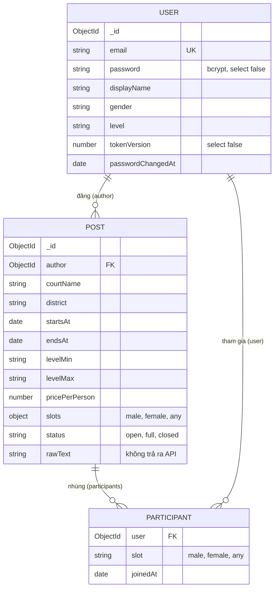

# Thiết kế cơ sở dữ liệu — Badminton Matching

> Cập nhật: 13/11/2026. MongoDB 8 + Mongoose 9. Database khi chạy trên máy: `badminton_matching`.
> Tài liệu liên quan: [API.md](API.md) · [project.md](project.md) (quy tắc BR-xx)

## 1. Nguyên tắc thiết kế

| Nguyên tắc | Cách làm | Lý do |
|---|---|---|
| Dữ liệu luôn đọc cùng nhau thì để chung | Người tham gia **nhúng trong document kèo** | Mở kèo là cần ngay danh sách người tham gia; tối đa 20 người nên document luôn nhỏ |
| Thay đổi chỗ phải nguyên tử | Tham gia / rời / hủy chạy trong **transaction** | Hai người bấm cùng lúc không lấy chung một chỗ cuối cùng |
| Hai lớp kiểm tra dữ liệu | express-validator ở route + schema Mongoose ở model | Route trả lỗi dễ hiểu; model chặn dữ liệu sai dù đi đường nào |
| Thời gian lưu UTC | Kiểu `Date` | Đổi sang giờ Việt Nam khi lọc theo ngày (`utils/vnTime.js`) và khi hiển thị |
| Không lộ dữ liệu nhạy cảm | Plugin `toJSON` toàn cục: `_id` → `id`, bỏ `__v`, **luôn xóa** `password` và `tokenVersion` | Lỡ trả nguyên document ra API cũng không lộ |
| Lưu tối thiểu thông tin cá nhân | Chỉ email, tên hiển thị, giới tính, trình độ | Không thu thập số điện thoại, ảnh, ngày sinh |

**Yêu cầu chạy:** MongoDB phải chạy dạng **replica set** thì mới dùng được transaction. MongoDB Atlas có sẵn. MongoDB cài trên máy: thêm `replication: replSetName: rs0` vào `mongod.cfg`, khởi động lại, rồi chạy `npm run db:init-replset` một lần. Nếu chưa bật, server vẫn khởi động nhưng in cảnh báo, và chức năng tham gia kèo sẽ lỗi.

## 2. Sơ đồ quan hệ

## 3. Các collection

### 3.1 `users`

Model: `backend/src/modules/user/user.model.js`

| Trường | Kiểu | Ràng buộc | Ghi chú |
|---|---|---|---|
| `email` | String | bắt buộc, **duy nhất**, chữ thường, bỏ khoảng trắng, ≤ 254 | Dùng để đăng nhập |
| `password` | String | bắt buộc, `select: false` | Hash bcrypt (10 vòng), không bao giờ lưu bản gốc |
| `displayName` | String | bắt buộc, 2 – 50 ký tự | Tên hiện cho người khác |
| `gender` | String | `male` / `female` | Xếp vào đúng loại chỗ (BR-10) |
| `level` | String | 7 mức `YEU` … `GIOI` | Kiểm tra khoảng trình độ (BR-09) |
| `tokenVersion` | Number | mặc định 0, `select: false` | Tăng 1 mỗi lần đổi mật khẩu; JWT mang số cũ bị từ chối |
| `passwordChangedAt` | Date | | Lần đổi mật khẩu gần nhất (tham khảo) |
| `createdAt`, `updatedAt` | Date | tự động | |

**Vì sao dùng `tokenVersion`, không so thời gian:** JWT chỉ ghi thời điểm cấp chính xác tới giây. Nếu so "đổi mật khẩu sau thời điểm cấp token", token cũ dùng trong cùng giây đổi mật khẩu vẫn lọt qua. So số phiên bản thì không phụ thuộc đồng hồ.

### 3.2 `posts`

Model: `backend/src/modules/post/post.model.js`

| Trường | Kiểu | Ràng buộc | Ghi chú |
|---|---|---|---|
| `author` | ObjectId → `users` | bắt buộc | Chủ kèo |
| `courtName` | String | bắt buộc, ≤ 100 | |
| `district` | String | thuộc 13 khu vực Hà Nội | Lọc danh sách |
| `address` | String | ≤ 200 | Không bắt buộc |
| `startsAt`, `endsAt` | Date | bắt buộc | UTC; BR-01, BR-02 kiểm tra ở `post.rules.js` |
| `levelMin`, `levelMax` | String | danh mục trình độ | BR-03 |
| `pricePerPerson` | Number | số nguyên 0 – 1.000.000 | VND / người (BR-04) |
| `slots.male`, `slots.female`, `slots.any` | Number | số nguyên 0 – 20, mặc định 0 | Số chỗ **cần thêm** (không tính chủ kèo); BR-05 |
| `participants[]` | mảng nhúng | xem 3.3 | |
| `status` | String | `open` / `full` / `closed`, mặc định `open` | Vòng đời: [project.md](project.md) mục 6 |
| `note` | String | ≤ 1000 | |
| `rawText` | String | ≤ 5000 | Nội dung bài gốc người dùng dán vào; dùng đánh giá bộ trích xuất (RQ1), **không trả ra API** |
| `createdAt`, `updatedAt` | Date | tự động | |

Số chỗ còn trống **không lưu** mà tính khi cần (`remainingSlots` trong `post.rules.js`) từ `slots` và `participants`, để không bao giờ lệch nhau.

### 3.3 `participants` (nhúng trong `posts`)

| Trường | Kiểu | Ghi chú |
|---|---|---|
| `user` | ObjectId → `users` | Người tham gia |
| `slot` | String | Loại chỗ người này đang giữ: `male` / `female` / `any` (BR-10) |
| `joinedAt` | Date | Thời điểm tham gia, giữ nguyên khi người khác vào / rời |

Không có `_id` riêng (`_id: false`). Mỗi người chỉ xuất hiện một lần trong một kèo (BR-08, kiểm tra trong transaction).

## 4. Index

| Collection | Index | Phục vụ |
|---|---|---|
| `users` | `{ email: 1 }` unique | Đăng nhập; chặn email trùng ở mức CSDL (an toàn cả khi 2 request đăng ký đến cùng lúc) |
| `posts` | `{ author: 1 }` | "Kèo tôi đã đăng" |
| `posts` | `{ status: 1, startsAt: 1 }` | Danh sách kèo sắp diễn ra, chưa hủy |
| `posts` | `{ district: 1, startsAt: 1 }` | Lọc theo khu vực |
| `posts` | `{ 'participants.user': 1 }` | "Kèo tôi đã tham gia" |

Index được tạo bằng `mongoose.syncIndexes()` mỗi lần server khởi động (`config/database.js`).

## 5. Truy vấn chính

| Việc | Truy vấn |
|---|---|
| Danh sách kèo | `{ startsAt: { $gt: now }, status: { $ne: 'closed' } }`, sắp `startsAt` tăng, tối đa 100 |
| Lọc theo ngày (giờ VN) | thêm `startsAt: { $gt: now, $gte: đầuNgàyVN, $lt: đầuNgàyVN + 24h }` |
| Lọc theo trình độ L | thêm `levelMin: { $in: [các mức ≤ L] }`, `levelMax: { $in: [các mức ≥ L] }` (lọc ngay trong CSDL) |
| Kèo tôi đã đăng / tham gia | `{ author: me }` / `{ 'participants.user': me }`, sắp `startsAt` giảm, tối đa 50 |
| Tham gia / rời / hủy | Trong `session.withTransaction()`: `findById` → `post.toRules()` → quy tắc → `save()` |

## 6. Dữ liệu mẫu

`npm run seed:demo` (thư mục `backend/`):
- Tạo 4 tài khoản `minh`, `lan`, `hung`, `thu` `@example.com` (mật khẩu `DEMO_PASSWORD`, mặc định `Demo@123`) và 5 kèo trong 3 ngày tới.
- **Chỉ xóa và tạo lại tài khoản `@example.com` cùng kèo của họ**; tài khoản khác giữ nguyên.
- Từ chối chạy khi `NODE_ENV=production`.

## 7. Dữ liệu nghiên cứu

Bộ dữ liệu 200 bài đăng gán nhãn (WBS 2.2) **không** nằm trong CSDL ứng dụng và **không** đưa bản thô lên Git (`data/raw/` đã bị bỏ qua trong `.gitignore`). Chỉ bản đã ẩn danh hóa mới được commit. Xem Charter mục 12.
