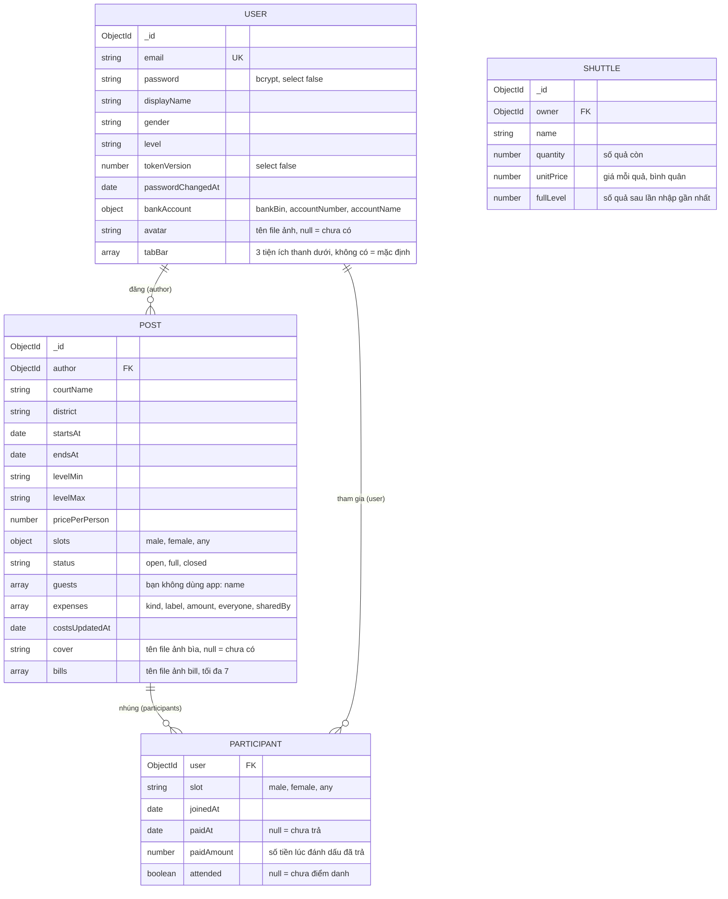

# Thiết kế cơ sở dữ liệu — Badminton Matching

> Cập nhật: 28/11/2026. MongoDB 8 + Mongoose 9. Database khi chạy trên máy: `badminton_matching`.
> Tài liệu liên quan: [API.md](API.md) · [project.md](project.md) (quy tắc BR-xx)

## 1. Nguyên tắc thiết kế

| Nguyên tắc | Cách làm | Lý do |
|---|---|---|
| Dữ liệu luôn đọc cùng nhau thì để chung | Người tham gia **nhúng trong document kèo** | Mở kèo là cần ngay danh sách người tham gia; tối đa 20 người nên document luôn nhỏ |
| Thay đổi chỗ phải nguyên tử | Tham gia / rời / hủy chạy trong **transaction** | Hai người bấm cùng lúc không lấy chung một chỗ cuối cùng |
| Hai lớp kiểm tra dữ liệu | express-validator ở route + schema Mongoose ở model | Route trả lỗi dễ hiểu; model chặn dữ liệu sai dù đi đường nào |
| Thời gian lưu UTC | Kiểu `Date` | Đổi sang giờ Việt Nam khi lọc theo ngày (`utils/vnTime.js`) và khi hiển thị |
| Không lộ dữ liệu nhạy cảm | Plugin `toJSON` toàn cục: `_id` → `id`, bỏ `__v`, **luôn xóa** `password` và `tokenVersion` | Lỡ trả nguyên document ra API cũng không lộ |
| Lưu tối thiểu thông tin cá nhân | Chỉ email, tên hiển thị, giới tính, trình độ | Không thu thập số điện thoại, ảnh, ngày sinh |

**Yêu cầu chạy:** MongoDB phải chạy dạng **replica set** thì mới dùng được transaction. MongoDB cài trên máy (và trên máy chủ chạy thật, [DEPLOY.md](DEPLOY.md)): thêm `replication: replSetName: rs0` vào `mongod.cfg`, khởi động lại, rồi chạy `npm run db:init-replset` một lần. Nếu chưa bật, server vẫn khởi động nhưng in cảnh báo, và chức năng tham gia kèo sẽ lỗi.

## 2. Sơ đồ quan hệ

## 3. Các collection

### 3.1 `users`

Model: `backend/src/modules/user/user.model.js`

| Trường | Kiểu | Ràng buộc | Ghi chú |
|---|---|---|---|
| `email` | String | bắt buộc, **duy nhất**, chữ thường, bỏ khoảng trắng, ≤ 254 | Dùng để đăng nhập |
| `password` | String | bắt buộc, `select: false` | Hash bcrypt (10 vòng), không bao giờ lưu bản gốc |
| `displayName` | String | bắt buộc, 2 – 50 ký tự | Tên hiện cho người khác |
| `gender` | String | `male` / `female` | Xếp vào đúng loại chỗ (BR-10) |
| `level` | String | 7 mức `YEU` … `GIOI` | Kiểm tra khoảng trình độ (BR-09) |
| `tokenVersion` | Number | mặc định 0, `select: false` | Tăng 1 mỗi lần đổi mật khẩu; JWT mang số cũ bị từ chối |
| `passwordChangedAt` | Date | | Lần đổi mật khẩu gần nhất (tham khảo) |
| `bankAccount.bankBin` | String | thuộc danh sách ngân hàng (`utils/banks.js`) | Tài khoản nhận tiền (WBS 4.8.1), **không bắt buộc**; cả object không có khi chưa nhập |
| `bankAccount.accountNumber` | String | 6 – 19 chữ số | Chỉ người đã tham gia kèo của chủ tài khoản mới thấy (BR-15) |
| `bankAccount.accountName` | String | 2 – 50 chữ cái **in hoa không dấu** | Server tự chuẩn hóa khi lưu |
| `phone` | String | không có, hoặc số di động `0(3|5|7|8|9)` + 8 chữ số | WBS 4.15; chỉ người cùng kèo thấy |
| `resetCodeHash`, `resetCodeExpires`, `resetAttempts`, `resetRequestedAt` | String, Date, Number, Date | `select: false`, không bao giờ trả ra ngoài | Quên mật khẩu (WBS 4.14): mã băm HMAC của mã OTP 4 số, hết hạn 10 phút, số lần nhập sai (5 lần thì hủy), chống gửi liên tục |
| `tabBar` | [String] | không có, hoặc đúng 3 mã khác nhau trong `search`, `mine`, `shuttles` | Thanh dưới trên điện thoại (WBS 4.12), lưu theo tài khoản |
| `avatar` | String | mặc định `null`; dạng `<32 hex>.webp` | Ảnh đại diện (WBS 4.9). Chỉ lưu **tên file**; API trả `avatarUrl = /uploads/avatars/<tên>` |
| `createdAt`, `updatedAt` | Date | tự động | |

**Vì sao dùng `tokenVersion`, không so thời gian:** JWT chỉ ghi thời điểm cấp chính xác tới giây. Nếu so "đổi mật khẩu sau thời điểm cấp token", token cũ dùng trong cùng giây đổi mật khẩu vẫn lọt qua. So số phiên bản thì không phụ thuộc đồng hồ.

### 3.2 `posts`

Model: `backend/src/modules/post/post.model.js`

| Trường | Kiểu | Ràng buộc | Ghi chú |
|---|---|---|---|
| `author` | ObjectId → `users` | bắt buộc | Chủ kèo |
| `courtName` | String | bắt buộc, ≤ 100 | |
| `district` | String | thuộc 13 khu vực Hà Nội | Lọc danh sách |
| `address` | String | ≤ 200 | Không bắt buộc |
| `startsAt`, `endsAt` | Date | bắt buộc | UTC; BR-01, BR-02 kiểm tra ở `post.rules.js` |
| `levelMin`, `levelMax` | String | danh mục trình độ | BR-03 |
| `pricePerPerson` | Number | số nguyên 0 – 1.000.000 | VND / người (BR-04) |
| `slots.male`, `slots.female`, `slots.any` | Number | số nguyên 0 – 20, mặc định 0 | Số chỗ **cần thêm** (không tính chủ kèo); BR-05 |
| `participants[]` | mảng nhúng | xem 3.3 | |
| `status` | String | `open` / `full` / `closed`, mặc định `open` | Vòng đời: [project.md](project.md) mục 6 |
| `note` | String | ≤ 1000 | |
| `guests[]` | `{ _id, name }` | tối đa 20, tên 1 – 30 ký tự | Bạn của chủ kèo **không dùng app** (WBS 4.8.2), chỉ có tên, vẫn được tính khi chia tiền |
| `expenses[]` | xem 3.4 | tối đa 30 | Các khoản chi; chỉ chủ kèo sửa (BR-16) |
| `costsUpdatedAt` | Date | | Lần sửa chi phí gần nhất (số liệu RQ1, RQ2) |
| `cover` | String | mặc định `null`; dạng `<32 hex>.webp` | Ảnh bìa (WBS 4.9); API trả `coverUrl = /uploads/covers/<tên>` |
| `bills[]` | [String] | tối đa 7, dạng `<32 hex>.webp` | Ảnh bill (WBS 4.11); chỉ người trong kèo thấy, file ở `UPLOAD_DIR/bills/` |
| `createdAt`, `updatedAt` | Date | tự động | |

**Ảnh không nằm trong CSDL.** File WebP nằm ở thư mục `UPLOAD_DIR` (`avatars/`, `covers/`), CSDL chỉ giữ tên file. Đổi hoặc xóa ảnh thì server xóa luôn file cũ; sao lưu phải gồm cả thư mục này ([DEPLOY.md](DEPLOY.md) mục 6).

Số chỗ còn trống **không lưu** mà tính khi cần (`remainingSlots` trong `post.rules.js`) từ `slots` và `participants`, để không bao giờ lệch nhau.

### 3.3 `participants` (nhúng trong `posts`)

| Trường | Kiểu | Ghi chú |
|---|---|---|
| `user` | ObjectId → `users` | Người tham gia |
| `slot` | String | Loại chỗ người này đang giữ: `male` / `female` / `any` (BR-10) |
| `joinedAt` | Date | Thời điểm tham gia, giữ nguyên khi người khác vào / rời |
| `paidAt` | Date \| null | Lúc chủ kèo đánh dấu người này đã chuyển tiền (BR-14); `null` = chưa trả. Giữ nguyên khi người khác vào / rời; ghi bằng toán tử vị trí `participants.$.paidAt` (một lệnh, không cần transaction) |
| `paidAmount` | Number \| null | Số tiền phải trả tại lúc được đánh dấu đã trả (BR-18); so với số hiện tại để biết "còn thiếu" / "trả dư" |
| `attended` | Boolean \| null | Điểm danh từ giờ bắt đầu: `true` có mặt, `false` vắng, `null` chưa điểm danh. Số liệu bùng kèo; không tự đổi phần chia tiền |
| `proofs[]`, `proofAt` | [String], Date | Ảnh chuyển khoản người chơi gửi (WBS 4.14), tối đa 3; chỉ chủ kèo và người gửi thấy |

Không có `_id` riêng (`_id: false`).

### 3.4 `expenses` (nhúng trong `posts`)

| Trường | Kiểu | Ghi chú |
|---|---|---|
| `kind` | String | `court` / `shuttle` / `water` / `food` / `other` |
| `label` | String | Tên khoản, bắt buộc với `other`, ≤ 40 ký tự |
| `amount` | Number | Số nguyên 0 – 10.000.000 |
| `everyone` | Boolean | "Chọn tất cả": luôn tính theo danh sách người hiện tại |
| `sharedBy` | [String] | Mã người cùng chịu khi `everyone = false`: `host`, `u:<userId>`, `g:<guestId>` |
| `quantity` | Number | Khoản `shuttle` theo số quả (WBS 4.10): 1 – 500; khi có thì `amount` = số quả × `unitPrice`, làm tròn lên 1.000đ (server tính) |
| `unitPrice` | Number | Giá mỗi quả lúc lưu (chép từ kho hoặc nhập tay) |
| `shuttle` | ObjectId → `shuttles` | Loại cầu trong kho của chủ kèo; không có = nhập giá tay (không trừ kho) |
| `shuttleName` | String | Tên loại cầu chép lúc lưu, vẫn hiện khi loại cầu bị xóa khỏi kho |

Số tiền mỗi người **không lưu** mà tính khi đọc (`computeDues` trong `post.costs.js`), để luôn đúng khi có người vào / rời hoặc chi phí thay đổi. Mỗi người chỉ xuất hiện một lần trong một kèo (BR-08, kiểm tra trong transaction).

### 3.5 `shuttles` (kho cầu, WBS 4.10)

Model: `backend/src/modules/shuttle/shuttle.model.js`. Mỗi document là **một loại cầu** của một người; tối đa 20 loại mỗi người.

| Trường | Kiểu | Ràng buộc | Ghi chú |
|---|---|---|---|
| `owner` | ObjectId → `users` | bắt buộc, có index | Chủ kho; mọi truy vấn đều lọc theo `owner` |
| `name` | String | 1 – 40 ký tự | |
| `quantity` | Number | số nguyên 0 – 10.000 | Số quả còn; trừ quá thì dừng ở 0 |
| `unitPrice` | Number | số nguyên 0 – 1.000.000 | Giá mỗi quả, bình quân theo số quả sau mỗi lần nhập |
| `fullLevel` | Number | số nguyên 0 – 10.000 | Số quả ngay sau lần nhập gần nhất (100% thanh mức cầu) |
| `createdAt`, `updatedAt` | Date | tự động | |

Kho bị trừ / hoàn **trong cùng transaction** với lần chủ kèo lưu chi phí (`post.service.js → updateCosts`): so số quả từng loại cầu giữa khoản "Cầu" cũ và mới của kèo, rồi cập nhật `quantity` bằng một lệnh pipeline `max(0, quantity − chênh lệch)`. Kèo bị hủy không tự hoàn kho (chỉnh bằng kiểm kê).

### 3.6 Nhắn tin (WBS 4.13)

Model: `backend/src/modules/chat/chat.model.js`. Quyền **không lưu** mà tính từ `posts` ở mỗi lần đọc / gửi (ai đang ở trong kèo, giờ kết thúc).

| Collection | Trường | Ghi chú |
|---|---|---|
| `conversations` | `key` (duy nhất), `kind` (`post` / `direct`), `post` (nhóm), `members` (nhắn riêng: 2 người), `lastMessage { text ≤ 200, sender, at }` | Tạo khi có tin đầu tiên; giữ tin cuối để hiện danh sách nhanh |
| `messages` | `key`, `sender`, `text` (1 – 1.000), `createdAt` | Chỉ chữ |
| `chatreads` | `user`, `key`, `at` | Lần cuối mở cuộc trò chuyện → tính "chưa đọc" |
| `blocks` | `blocker`, `blocked`, `createdAt` | Chặn nhắn riêng |

### 3.7 `postevents` — nhật ký sự kiện của kèo (US-22, WBS 6.3)

Model: `backend/src/modules/post/postEvent.model.js`. Mỗi dòng là **một sự kiện**, ghi **trong cùng transaction** với thao tác chính (thao tác bị từ chối thì không ghi). Có từ 28/11/2026; kèo cũ hơn không có nhật ký.

| Trường | Kiểu | Ghi chú |
|---|---|---|
| `post` | ObjectId → `posts` | |
| `user` | ObjectId → `users` \| null | Người liên quan; `null` với `full`, `reopen` |
| `type` | String | `created`, `join`, `leave`, `full`, `reopen`, `cancel`, `costs_saved`, `paid`, `unpaid`, `proof`, `attendance` |
| `at` | Date | Thời điểm |
| `meta` | Object | Theo loại: `slots` (created), `slot` (join / leave), `amount` (paid), `total` / `expenses` / `notAll` / `guests` (costs_saved), `attended` (attendance) |

**Chỉ có mã và số**: không tên, email, số điện thoại, tên sân, nội dung tin nhắn. Dùng cho lệnh xuất số liệu ẩn danh (mã giả thay cho id). `npm run seed:demo` xóa luôn nhật ký của kèo mẫu cũ.

## 4. Index

| Collection | Index | Phục vụ |
|---|---|---|
| `users` | `{ email: 1 }` unique | Đăng nhập; chặn email trùng ở mức CSDL (an toàn cả khi 2 request đăng ký đến cùng lúc) |
| `posts` | `{ author: 1 }` | "Kèo tôi đã đăng" |
| `posts` | `{ status: 1, startsAt: 1 }` | Danh sách kèo sắp diễn ra, chưa hủy |
| `posts` | `{ district: 1, startsAt: 1 }` | Lọc theo khu vực |
| `posts` | `{ 'participants.user': 1 }` | "Kèo tôi đã tham gia" |
| `shuttles` | `{ owner: 1 }` | Kho cầu của một người |
| `conversations` | `{ key: 1 }` unique · `{ members: 1 }` · `{ post: 1 }` | Mở một cuộc trò chuyện; danh sách nhắn riêng / nhóm của tôi |
| `messages` | `{ key: 1, createdAt: -1 }` | Tin mới nhất của một cuộc trò chuyện, phân trang |
| `chatreads` | `{ user: 1, key: 1 }` unique | Tin chưa đọc |
| `postevents` | `{ post: 1, at: 1 }` · `{ at: 1 }` | Nhật ký của một kèo theo thời gian; lọc theo khoảng thời gian khi xuất số liệu |
| `blocks` | `{ blocker: 1, blocked: 1 }` unique | Kiểm tra chặn |

Index được tạo bằng `mongoose.syncIndexes()` mỗi lần server khởi động (`config/database.js`).

## 5. Truy vấn chính

| Việc | Truy vấn |
|---|---|
| Danh sách kèo | `{ startsAt: { $gt: now }, status: { $ne: 'closed' } }`, sắp `startsAt` tăng, tối đa 100 |
| Lọc theo ngày (giờ VN) | thêm `startsAt: { $gt: now, $gte: đầuNgàyVN, $lt: đầuNgàyVN + 24h }` |
| Lọc theo trình độ L | thêm `levelMin: { $in: [các mức ≤ L] }`, `levelMax: { $in: [các mức ≥ L] }` (lọc ngay trong CSDL) |
| Kèo tôi đã đăng / tham gia | `{ author: me }` / `{ 'participants.user': me }`, sắp `startsAt` giảm, tối đa 50 |
| Tham gia / rời / hủy | Trong `session.withTransaction()`: `findById` → `post.toRules()` → quy tắc → `save()` |

## 6. Dữ liệu mẫu

`npm run seed:demo` (thư mục `backend/`):
- Tạo 4 tài khoản `minh`, `lan`, `hung`, `thu` `@example.com` (mật khẩu `DEMO_PASSWORD`, mặc định `Demo@123`) và 5 kèo trong 3 ngày tới.
- **Chỉ xóa và tạo lại tài khoản `@example.com` cùng kèo của họ**; tài khoản khác giữ nguyên.
- Từ chối chạy khi `NODE_ENV=production`.
- Xóa luôn tin nhắn, cuộc trò chuyện, lượt đọc, lượt chặn và kho cầu của tài khoản mẫu cũ.
- Không xóa file ảnh của tài khoản / kèo mẫu cũ; khi cần dọn, xóa thư mục `backend/uploads/` (đã nằm trong `.gitignore`).

## 7. Dữ liệu nghiên cứu

Bộ dữ liệu 100 bài đăng gán nhãn (WBS 2.2) **không** nằm trong CSDL ứng dụng và **không** đưa bản thô lên Git (`data/raw/` đã bị bỏ qua trong `.gitignore`). Chỉ bản đã ẩn danh hóa mới được commit. Xem Charter mục 12.
