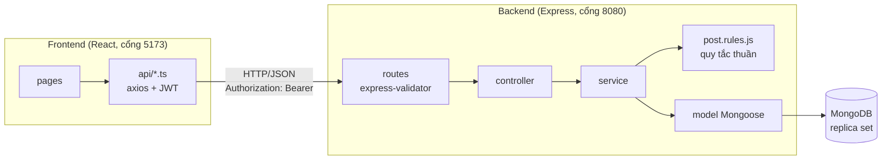
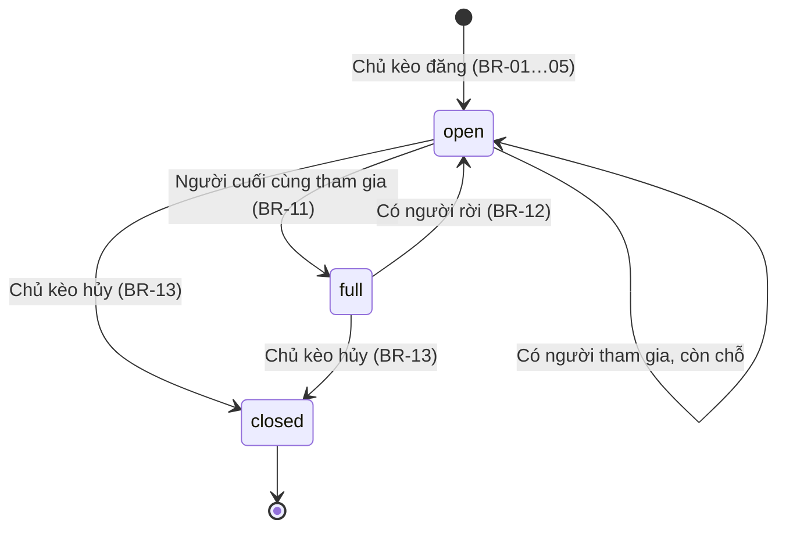

# Tổng quan dự án — Badminton Matching

> Đồ án cá nhân: An Đức Mạnh (MSSV 23110310). Cập nhật: 17/11/2026.
> Tài liệu liên quan: [Charter](01-project-charter.md) · [API.md](API.md) · [database.md](database.md) · [QUALITY.md](QUALITY.md) · [RISKS.md](RISKS.md) · [GIT.md](GIT.md)

## 1. Mục tiêu và phạm vi

Nền tảng web giúp người chơi cầu lông **đăng kèo thiếu người, tìm kèo còn chỗ và tham gia ngay**, thay cho việc đăng bài tự do trong các hội nhóm Facebook. Điểm khác biệt là chức năng **dán bài → tự điền**: người dùng dán nội dung bài đăng quen thuộc (ví dụ *"Tối nay 19h-21h sân Cầu Giấy thiếu 2 nam 1 nữ TB- đến TB+, 50k/ng"*), hệ thống trích ra thời gian, chi phí, số chỗ và trình độ để điền sẵn form.

Phạm vi chi tiết, mục tiêu đo được và câu hỏi nghiên cứu: xem [Charter](01-project-charter.md) mục 3–5.

**Lộ trình:** giai đoạn 1 là **ứng dụng web** (phạm vi đồ án, hạn hoàn thành 15/12/2026). Giai đoạn 2 là **app di động** bằng React Native + Expo, làm sau khi bảo vệ, dùng lại nguyên backend và API của giai đoạn 1 ([Charter](01-project-charter.md) mục 7.1, [WBS](02-wbs.md) mục 5).

## 2. Công nghệ

| Phần | Công nghệ | Lý do chọn |
|---|---|---|
| Backend | Node.js 24 LTS, Express 5 (CommonJS) | Phổ biến, nhẹ; Node 24 còn được hỗ trợ tới 04/2028 |
| CSDL | MongoDB 8 + Mongoose 9 | Có transaction (chống tranh chỗ); chạy thật trên máy chủ riêng ([DEPLOY.md](DEPLOY.md)) |
| Xác thực | JWT (hạn 7 ngày) + bcrypt | Không cần lưu phiên phía server |
| Kiểm tra dữ liệu | express-validator (ở route) + schema Mongoose (ở model) | Hai lớp bảo vệ |
| Bảo mật | helmet, cors, express-rate-limit | Header an toàn, chỉ cho frontend gọi, chống dò mật khẩu |
| Frontend | React 19, Vite, TypeScript, React Router 7, Axios | Kiểm tra kiểu khi build, phát hiện sớm khi API đổi |
| Giao diện | CSS thuần (`frontend/src/styles.css`) | Không phụ thuộc thư viện; kiểu app trên điện thoại / máy tính bảng (dưới 1024px), kiểu web trên máy tính; PWA cài được |
| Kiểm thử | Jest + Supertest + MongoDB chạy trong RAM; Vitest + React Testing Library | Test chạy độc lập, không cần cài CSDL |
| CI | GitHub Actions | Chạy test trên mọi push và Pull Request |

## 3. Kiến trúc

### 3.1 Kiểu kiến trúc: modular monolith

Một ứng dụng backend duy nhất, chia **theo chức năng** (module). Mỗi module tự chứa routes → controller → service → model. Quy tắc nghiệp vụ của kèo tách riêng thành hàm thuần (`post.rules.js`), không phụ thuộc CSDL, nên kiểm thử nhanh và dễ đọc.



Luồng xử lý khi người dùng bấm **"Tham gia kèo"**:

1. Frontend gọi `POST /api/posts/:id/join` kèm JWT.
2. `auth.middleware` giải mã token, đọc lại người dùng trong CSDL (giới tính, trình độ).
3. `post.service` mở **transaction**: đọc kèo → `post.toRules()` → `rules.joinPost()` áp BR-06…BR-11 → ghi lại.
4. Nếu hai người bấm cùng lúc, MongoDB báo xung đột ghi cho transaction đến sau; transaction đó tự chạy lại, đọc thấy chỗ đã bị lấy và trả `409 NO_SLOT` / `POST_NOT_OPEN`.

### 3.2 Cấu trúc thư mục

```
backend/src/
├─ app.js                 Tạo app Express (dùng chung cho server và test)
├─ server.js              Đọc .env, kiểm tra cấu hình, kết nối MongoDB, mở cổng
├─ config/                database.js (kết nối + cảnh báo replica set), mongoose.js (plugin toJSON)
├─ middlewares/           auth, error, validate, rateLimit
├─ modules/
│  ├─ auth/               đăng ký, đăng nhập, đổi mật khẩu, ký JWT
│  ├─ user/               model User, hồ sơ, rule express-validator dùng chung
│  ├─ post/               model, rules (BR), service (transaction), serializer, routes
└─ utils/                 AppError, asyncHandler, hằng số, giờ VN, chính sách mật khẩu, script

frontend/src/
├─ api/                   client.ts (axios, JWT, dịch mã lỗi) + mỗi tài nguyên một file
├─ components/            Layout, Navbar (máy tính), TabBar (điện thoại), AccountLayout, PageHeader, PostCard, Menu, Icon, RequireAuth, ui
├─ context/               AuthContext (trạng thái đăng nhập)
├─ pages/                 10 trang
├─ utils/                 hằng số, định dạng, chuyển đổi form, logic điều hướng
├─ types.ts               kiểu dữ liệu dùng chung
└─ styles.css             toàn bộ CSS
```

### 3.3 Nguyên tắc kỹ thuật

- **Không tin dữ liệu từ client:** route chỉ lấy đúng các trường cho phép; người dùng không tự đặt được chủ kèo, trạng thái, người tham gia, `tokenVersion`.
- **Không tin dữ liệu trong JWT:** mỗi request đọc lại người dùng trong CSDL.
- **Một định dạng lỗi duy nhất** `{ success, message, code, errors }`; frontend hiển thị theo `code` ([API.md](API.md) mục 4).
- **Giờ Việt Nam:** CSDL lưu UTC; mọi phép tính "ngày" (lọc theo ngày, dữ liệu mẫu) đi qua `utils/vnTime.js`, vì server và CI có thể chạy ở múi giờ khác.
- **Không lộ thông tin cá nhân:** API công khai chỉ trả tên hiển thị; không trả email người khác; số tài khoản và chi phí chỉ người trong kèo thấy (BR-15).

## 4. Vai trò

| Vai trò | Làm được |
|---|---|
| Khách (chưa đăng nhập) | Xem, lọc danh sách kèo; xem chi tiết kèo (không thấy chi phí, số tài khoản) |
| Người chơi (đã đăng nhập) | Mọi quyền của khách + đăng kèo, tham gia / rời kèo, xem "Kèo của tôi", sửa hồ sơ, đổi mật khẩu |
| Chủ kèo | Người chơi đã đăng kèo đó: hủy kèo (BR-13); không tự tham gia kèo của mình (BR-07) |

## 5. Chức năng

| Mã | Chức năng | Màn hình | API | Trạng thái |
|---|---|---|---|---|
| F1 | Đăng ký, đăng nhập, đăng xuất | Đăng ký, Đăng nhập, Tài khoản | `/auth/register`, `/auth/login` | Xong |
| F2 | Hồ sơ, đổi mật khẩu | Hồ sơ cá nhân, Đổi mật khẩu | `/users/me`, `/auth/change-password` | Xong |
| F3 | Danh sách kèo + lọc khu vực / ngày / trình độ | Tìm kèo, Hôm nay | `GET /posts` | Xong |
| F4 | Đăng kèo (chi phí dự kiến mỗi người) | Đăng kèo | `POST /posts` | Xong |
| F5 | Chi tiết, tham gia, rời, hủy kèo | Chi tiết kèo | `/posts/:id/…` | Xong |
| F6 | Kèo của tôi (đã đăng / đã tham gia) | Kèo của tôi, Tài khoản | `GET /users/me/posts` | Xong |
| F7 | Chi phí theo từng khoản (chọn người chịu, bạn không dùng app, ai trong kèo cũng xem được), thu tiền bằng mã QR (còn thiếu / trả dư), điểm danh | Chi tiết kèo, Hồ sơ | `PUT /posts/:id/costs`, `PUT /posts/:id/attendance`, `PATCH …/payment`, `PUT/DELETE /users/me/bank-account` | Xong (tin nhắn tổng kết, lịch sử chi tiêu: chưa) |
| F8 | Thông báo email | — | — | Chưa (Should) |
| F9 | Đánh giá uy tín sau kèo | — | — | Chưa (Could) |
| F10 | App di động Android / iOS (React Native + Expo): toàn bộ F1–F6 + thông báo đẩy | App | Dùng lại API hiện có | Giai đoạn 2, sau đồ án |

## 6. Quy tắc nghiệp vụ

Mỗi quy tắc có mã **BR-xx**. Mã này xuất hiện trong code (`backend/src/modules/post/post.rules.js`) và trong tên test, để tra ngược từ quy tắc tới code và bằng chứng kiểm thử.

| Mã | Quy tắc | Lỗi khi vi phạm | Test |
|---|---|---|---|
| BR-01 | Giờ bắt đầu kèo phải ở tương lai | 400 `VALIDATION_ERROR` (`startsAt`) | `post.rules.test.js`, `post.test.js` |
| BR-02 | Thời lượng kèo > 0 và ≤ 6 giờ | 400 `VALIDATION_ERROR` (`endsAt`) | `post.rules.test.js`, `post.test.js` |
| BR-03 | Trình độ tối thiểu ≤ trình độ tối đa | 400 `VALIDATION_ERROR` (`levelMin`) | `post.rules.test.js` |
| BR-04 | Chi phí mỗi người là số nguyên 0 – 1.000.000đ | 400 `VALIDATION_ERROR` (`pricePerPerson`) | `post.rules.test.js`, `post.model.test.js` |
| BR-05 | Tổng số chỗ 1 – 20, mỗi loại chỗ là số nguyên không âm | 400 `VALIDATION_ERROR` (`slots`) | `post.rules.test.js` |
| BR-06 | Chỉ tham gia kèo đang `open` và chưa bắt đầu | 409 `POST_NOT_OPEN` / `POST_STARTED` | `post.rules.test.js`, `post.test.js` |
| BR-07 | Chủ kèo không tự tham gia kèo của mình | 409 `IS_AUTHOR` | `post.rules.test.js`, `post.test.js` |
| BR-08 | Mỗi người tham gia một kèo tối đa một lần | 409 `ALREADY_JOINED` | `post.rules.test.js`, `post.test.js` |
| BR-09 | Trình độ người chơi phải nằm trong khoảng của kèo | 409 `LEVEL_MISMATCH` | `post.rules.test.js`, `post.test.js` |
| BR-10 | Ưu tiên chỗ dành cho đúng giới tính; hết thì dùng chỗ chung ("nam hoặc nữ") | 409 `NO_SLOT` | `post.rules.test.js`, `post.test.js` |
| BR-11 | Hết chỗ → kèo tự chuyển `full` | — | `post.rules.test.js`, `post.test.js` (5 người cùng lúc) |
| BR-12 | Chỉ rời kèo trước giờ bắt đầu; kèo `full` có người rời → mở lại `open` | 409 `POST_STARTED` / `NOT_JOINED` | `post.rules.test.js`, `post.test.js` |
| BR-13 | Chỉ chủ kèo được hủy kèo, chỉ trước giờ bắt đầu; kèo đã hủy ẩn khỏi danh sách, không ai tham gia / rời được | 403 `NOT_AUTHOR`, 409 `POST_STARTED` / `POST_NOT_OPEN` | `post.rules.test.js`, `post.test.js` |
| BR-14 | Chỉ chủ kèo đánh dấu người tham gia đã / chưa trả tiền; người đó phải đang trong kèo; kèo đã hủy thì không đánh dấu được | 403 `NOT_AUTHOR`, 409 `NOT_JOINED` / `POST_NOT_OPEN` | `tests/post/payment.test.js` |
| BR-15 | Tài khoản nhận tiền của chủ kèo và trạng thái đã trả chỉ hiện cho chủ kèo và người đã tham gia kèo đó | Không trả trường `payment`, `paid` | `tests/post/payment.test.js` |
| BR-16 | Chỉ chủ kèo sửa chi phí (khoản chi, bạn không dùng app) và điểm danh; sửa chi phí **bất cứ lúc nào** trừ kèo đã hủy; điểm danh từ giờ bắt đầu | 403 `NOT_AUTHOR`, 409 `POST_NOT_OPEN` / `NOT_STARTED` | `tests/post/costs.rules.test.js`, `payment.test.js` |
| BR-17 | Mỗi khoản chia đều cho người được chọn ("Chọn tất cả" = mọi người hiện có, gồm người vào sau; người đã rời tự bị loại); mỗi người trả tổng phần của mình, làm tròn lên 1.000đ; mỗi khoản 0 – 10.000.000đ, tối đa 30 khoản, ít nhất 1 người chịu | 400 `VALIDATION_ERROR` | `tests/post/costs.rules.test.js`, `payment.test.js` |
| BR-18 | Đánh dấu đã trả lưu số tiền lúc đó; nếu sau đó phải trả nhiều hơn → "còn thiếu" (có mã QR cho phần thiếu), ít hơn → "trả dư" (chủ kèo tự hoàn lại ngoài app) | — | `tests/post/costs.rules.test.js`, `payment.test.js` |

### Vòng đời một kèo



Kèo đã qua giờ bắt đầu vẫn giữ trạng thái cũ trong CSDL, nhưng không còn hiện trong danh sách và không thay đổi được nữa (BR-06, BR-12, BR-13).

## 7. Chi phí theo từng khoản và thu tiền (Charter 2.0)

File `backend/src/modules/post/post.costs.js` (hàm thuần) và `post.serializer.js`.

- Chủ kèo thêm các **khoản chi** (sân, cầu, nước, ăn, khác) và **bạn không dùng app**; mỗi khoản chọn người cùng chịu hoặc "Chọn tất cả".
- Khi đọc kèo, server tính số tiền mỗi người (BR-17), trạng thái trả tiền (BR-18) và mã QR VietQR cho đúng số còn phải chuyển.
- Ví dụ: sân 320.000đ chia 4 người, ăn 300.000đ chia 3 người đi ăn → người đi ăn 180.000đ, người chỉ đánh 80.000đ.
- Bộ trích xuất bài đăng ("dán bài → tự điền") đã **bỏ ngày 24/11/2026** khi đổi trọng tâm nghiên cứu ([Charter](01-project-charter.md) mục 14); code cũ còn trong lịch sử Git (tag `v0.2.0`).

## 8. Chạy dự án

Xem [README](../README.md) mục "Chạy dự án". Tài khoản mẫu sau `npm run seed:demo`: `minh`, `lan`, `hung`, `thu` `@example.com`, mật khẩu `Demo@123`.
